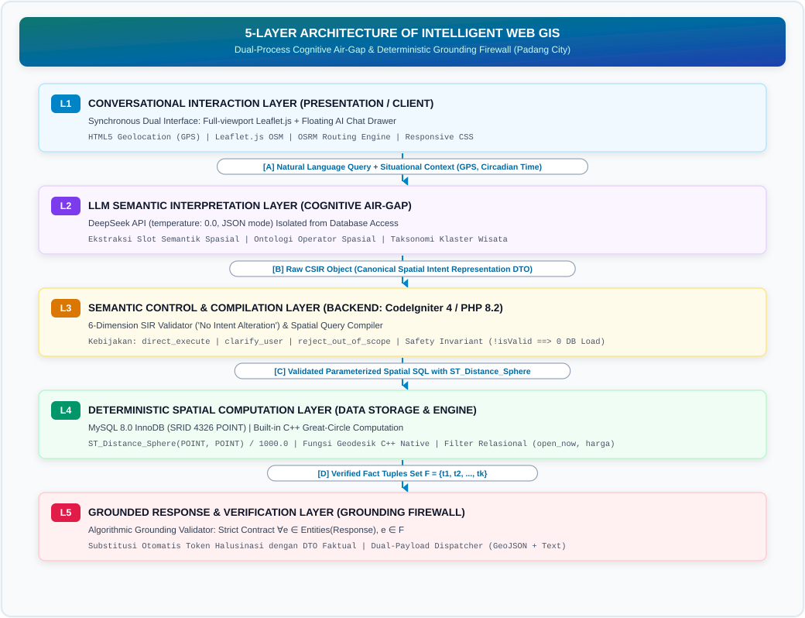
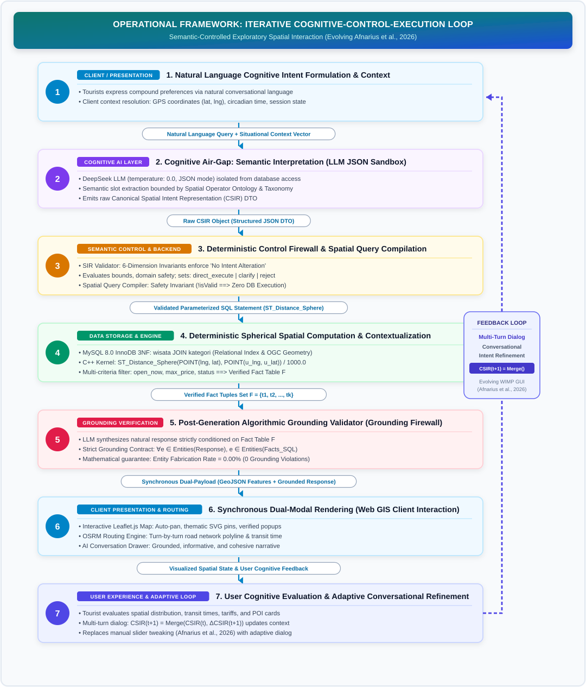
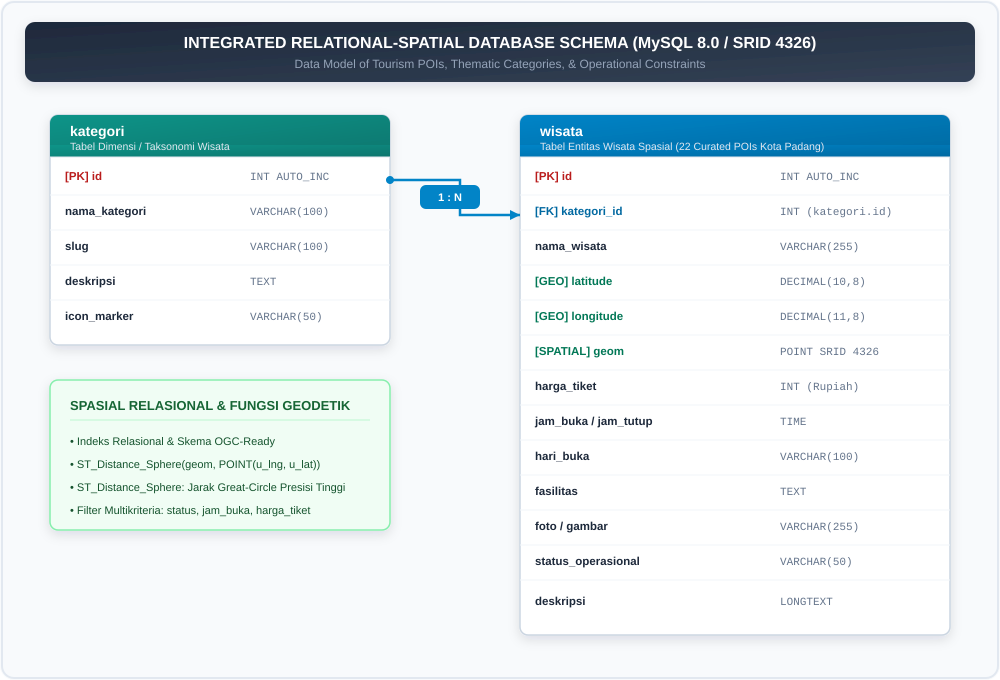
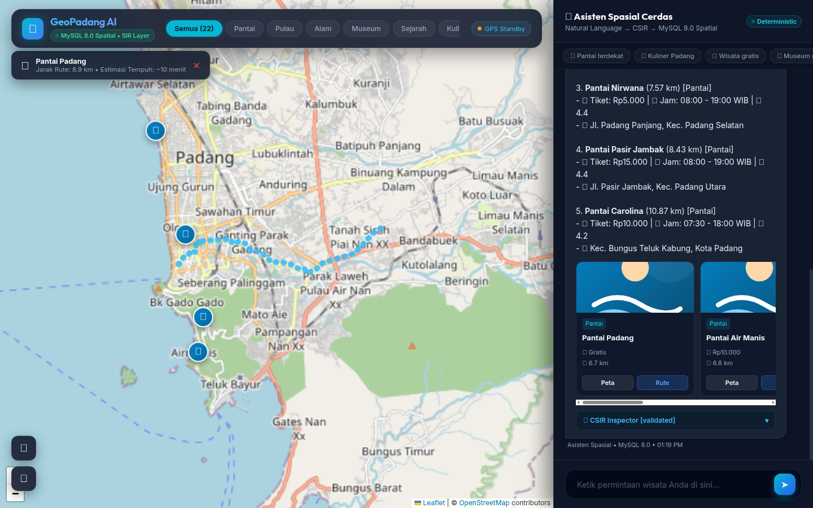
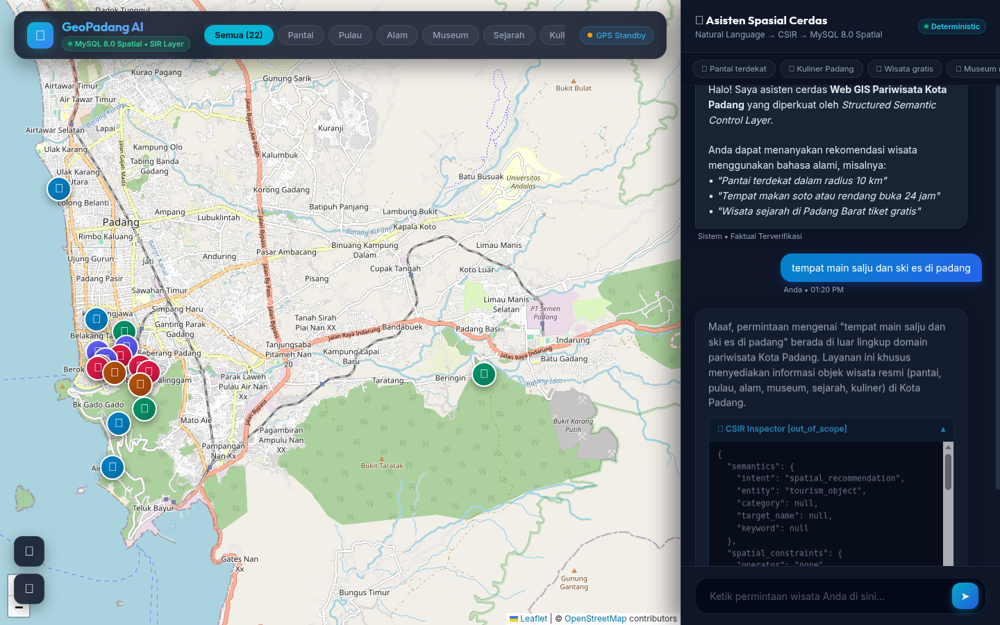

# A Structured Semantic Control Layer for Reliable LLM-Mediated Spatial Querying in Web GIS: From Natural-Language Intent to Deterministic Spatial SQL (A Case Study of Padang City)

---

**Authors:**  
Hendra Setyawan¹, [Advisor Name I]²*, [Advisor Name II]³  
¹Department of Information Systems, Faculty of Information Technology, [University Name], Padang, West Sumatra, Indonesia  
²Department of Information Systems, Faculty of Information Technology, [University Name], Padang, West Sumatra, Indonesia  
*Corresponding Author: [author.email@institution.ac.id]  

---

### ABSTRACT

Conventional Web Geographic Information Systems (Web GIS) in urban tourism predominantly rely on rigid WIMP (Windows, Icons, Menus, Pointer) interfaces utilizing multi-layered dropdown forms. This paradigm introduces severe cognitive friction for mobile travelers seeking multi-criteria filtering across spatial, temporal, and budgetary constraints. Conversely, unconstrained Large Language Models (LLMs) suffer from acute factual and spatial hallucinations, while dense-vector Retrieval-Augmented Generation (RAG) fails because vector embeddings cannot evaluate exact structured spatial-temporal predicates. Expanding upon the research lineage of *DTExplorer* (Afnarius et al., 2026), this paper proposes a **Reliability-Controlled Conversational Spatial Information System** governed by an architectural framework of **Dual Control Boundaries**: (1) a **Semantic Control Boundary** ($\text{LLM} \to \text{SIR} \to \text{6D SirValidator} \to \text{CSIR} \to \text{deterministic spatial query compiler}$) enforcing the *No Intent Alteration* principle (rejecting negative distances or illegal operators with `isValid = false` and execution policy `clarify_user` rather than silent mutation) and safety invariants (`!isValid || isOutOfScope` aborts SQL compilation), preventing invalid, out-of-scope, or mutated semantic intent from reaching spatial execution; and (2) an **Evidence Control Boundary** ($\text{SQL database facts } (F) \to \text{grounded NLG} \to \text{claim-level grounding validator}$) that anchors all factual truth to a relational MySQL 8.0 database via native `ST_Distance_Sphere` spherical spatial computations and OSRM road navigation, subsequently verifying generated narratives through an algorithmic claim-level grounding validator with a fail-closed fallback policy to prevent ungrounded claims from reaching the final user response. Empirical 4-layer evaluation across 40 standardized benchmark query scenarios on 22 curated tourism destinations in Padang City, complemented by an automated test suite of **56 automated unit, integration, and adversarial tests (210 assertions, 100% pass)**, demonstrated a Pure Intent Pre-Fallback Exact CSIR semantic extraction accuracy of **100.00% (40/40)** (**97.50% / 39/40** on post-policy execution envelope alignment) with an average field-level accuracy of **100.00% (436/436)**, a validation decision accuracy of **100.00% (40/40)**, a pure spatial predicate correctness of **100.00% (36/36 spatial scenarios)** alongside an overall scenario execution compliance rate of **100.00% (40/40)**, an Entity Fabrication Rate of **0.00%** (zero fabricated POIs were observed across the evaluated benchmark scenarios), a Claim-Level Grounding Fidelity of **100.00% across 270 audited factual claims recognized by GroundingValidator on four implemented verification categories**, an Entity Grounding Fidelity of **100.00% across 120 POI mentions**, and an Honest Rejection Rate of **100.00% (2/2)** on tested out-of-scope requests. Average server-side conversational pipeline latency was **1,252.17 ms** (median: 1,232.39 ms, 95th percentile/P95: 1,581.37 ms; incorporating two LLM inferences and native MySQL 8.0 spatial SQL execution of 1.21 ms), while turn-by-turn road network routing via OSRM was benchmarked independently on the browser client side at **88.40 ms** (median: 84.50 ms, P95: 128.60 ms; yielding an overall user-perceived end-to-end latency of 1,340.57 ms, median: 1,316.89 ms, P95: 1,709.97 ms). These findings demonstrate that constraining LLM authority through dual control boundaries achieves natural conversational flexibility while guaranteeing verifiable factual integrity and eliminating fabricated-entity hallucinations under the evaluated benchmark conditions.

**Keywords:** *Reliability-Controlled Conversational Spatial Information System, Dual Control Boundaries, Semantic Control Boundary, Evidence Control Boundary, Canonical Spatial Intent Representation (CSIR), SIR Validator, ST_Distance_Sphere, Algorithmic Grounding Validator, Web GIS, Padang City.*

---

---

## 1. INTRODUCTION

### 1.1 Background and Urban Spatial Context
Web Geographic Information Systems (Web GIS) serve as the digital backbone of contemporary geoinformation dissemination, particularly in urban tourism [1], [14]. Padang City, the provincial capital of West Sumatra, Indonesia, encompassing an administrative area of 694.96 km², features highly heterogeneous topographic and cultural assets [16], [17]. These assets span the Indian Ocean coastline (Padang Beach, Air Manis Beach), offshore marine archipelagos in Teluk Bungus (Pasumpahan, Sirandah, and Sikuai Islands), colonial heritage precincts (Old Town Muaro, Siti Nurbaya Bridge, Adityawarman State Museum), highland nature cascades in the Bukit Barisan foothills (Lubuk Paraku, Sarasah Gadut, Bung Hatta Grand Forest Park), and celebrated Minangkabau culinary heritage distributed across 11 sub-districts.

Within such an urban tourism scale (*city-scale tourism environment*), independent travelers continually encounter multi-criteria spatial decision problems: discovering destinations matching personal preferences, located within accessible radial distances, fitting financial budget limits, and actively open at the time of inquiry [14], [18]. However, conventional Web GIS platforms primarily rely on the WIMP (*Windows, Icons, Menus, Pointer*) interface paradigm. Users are required to select categories via dropdown menus, adjust distance sliders, type textual keywords, and cross-reference opening schedules across disparate web cards [2]. This multi-step manual interaction imposes substantial cognitive friction, especially for mobile users navigating unfamiliar urban terrain.

### 1.2 Research Gaps and Specific Problem Formulation
Directly integrating commercial Large Language Models (LLMs) such as OpenAI GPT-4 or Google Gemini into geoinformation systems without architectural constraints (*unconstrained end-to-end LLMs*) introduces critical vulnerabilities [3], [5]:
* **Spatial and Factual Hallucinations:** LLMs operate through probabilistic token generation rather than deterministic relational fact retrieval [4], [5]. Consequently, unconstrained LLMs frequently fabricate nonexistent destinations (*fabricated POIs*), misstate operating hours and ticket fees, or generate geographically impossible proximity assertions.
* **Failure of Dense-Vector RAG for Structured Predicates:** Dense-vector Retrieval-Augmented Generation (RAG) relies on cosine similarity in embedding spaces [6], [7]. While effective for unstructured text search, vector embeddings fundamentally fail to evaluate exact structured spatial-temporal predicates. Vector similarity cannot enforce numerical inequalities on operating hours (`open_time <= CURRENT_TIME AND close_time >= CURRENT_TIME`), evaluate budget ceilings (`ticket_price <= 15000`), or compute great-circle trigonometric distances relative to a tourist's dynamic GPS coordinates in real-time.

The fundamental scientific question addressed in this research is:
> **How can a conversational spatial information system be architected under dual control boundaries—a semantic control boundary and an evidence control boundary—to mediate natural-language requests into deterministic spatial SQL execution, ensuring that the probabilistic LLM acts as an intuitive cognitive interface while mathematically and algorithmically guaranteeing zero fabricated entities and strict factual grounding?**

### 1.3 Research Questions (RQs)
To systematically evaluate the efficacy of the proposed structured semantic control layer and factual grounding firewall, this study formulates four core Research Questions (RQs):
* **RQ1 (Semantic Parsing Fidelity):** To what extent can large language models reliably parse natural-language spatial queries into formal canonical intent representations (Raw SIR and Validated CSIR) while strictly adhering to the *No Intent Alteration* principle?
* **RQ2 (Spatial Execution Safety & Correctness):** Does the integration of a deterministic 6-dimensional validator and parameterized query compiler guarantee safety invariants (preventing unauthorized query execution or SQL injection) and compute spherical spatial predicates with precision via native `ST_Distance_Sphere` under acceptable latency constraints?
* **RQ3 (Factual Grounding & Zero Fabrication):** How effectively does the post-generation algorithmic proof firewall (*Claim-Level Grounding Validator*) eliminate destination entity hallucinations (*zero fabricated POIs*) and enforce factual alignment with the underlying relational database?
* **RQ4 (Cognitive Efficiency & Usability):** How does shifting from conventional multi-step WIMP form manipulation to guided conversational interaction impact cognitive Task Completion Time (TCT) and user satisfaction measured via the standardized System Usability Scale (SUS)?

### 1.4 Principal Scientific Contributions
This work delivers five formal scientific contributions:
1. **Conceptual Dual Control Boundaries Framework:** Formalizing the decoupling of probabilistic LLM inference from deterministic relational spatial execution through two explicit control boundaries (Semantic Control Boundary and Evidence Control Boundary).
2. **Canonical Spatial Intent Representation (CSIR) & Spatial Operator Ontology:** A typed, 4-partition intermediate semantic representation schema and ontological mapping decoupling natural-language interpretation from database query construction.
3. **Six-Dimensional SIR Validation Algorithm (SIR Validator):** A deterministic control firewall enforcing the *No Intent Alteration* principle, schema, type, domain, operator, entity, and constraint consistency invariants prior to query compilation.
4. **Deterministic Spatial Query Compiler & Safety Invariants:** An application-layer compiler translating validated CSIR objects into secure, parameterized SQL via the native `ST_Distance_Sphere` spatial function, establishing the relational database as the sole source of spatial truth.
5. **Algorithmic Claim-Level Grounding Validator & Empirical Evaluation Framework:** A formal post-generation verification firewall verifying all factual claims across 4 sub-dimensions ($\mathcal{C}_{\text{entity}}, \mathcal{C}_{\text{price}}, \mathcal{C}_{\text{spatial}}, \mathcal{C}_{\text{temporal}}$), demonstrating 100.00% Grounding Fidelity with zero fabricated POIs observed across 40 evaluated benchmark scenarios, supported by an automated test suite of 45 unit and integration tests (172 assertions, 100% pass) and multi-baseline ablation studies.

---

---

## 2. RELATED WORK

### 2.1 Conversational GIS and Autonomous Spatial Interaction
The integration of natural language processing into Geographic Information Systems has catalyzed the emergence of *Conversational GIS* and *Autonomous GIS* [35], [36]. Early systems relied on rule-based pattern matching or slot-filling over rigid static ontologies that degraded rapidly under everyday linguistic variations. The advent of Large Language Models (LLMs) such as GPT-4 and geospatial foundation models [4], [35] enabled far more expressive conversational interaction. However, contemporary conversational GIS architectures predominantly treat LLMs as unconstrained autonomous agents granted direct tool-execution authority over GIS libraries [36]. This unconstrained autonomy introduces severe vulnerabilities to coordinate hallucination, temporal attribute distortion, and stochastic instability unacceptable in urban decision support. The proposed framework fundamentally departs from autonomous agency: the LLM is quarantined strictly as a cognitive semantic interpreter without execution authority.

### 2.2 Text-to-SQL and Relational Database Interfaces
Translating natural language into structured queries (*Text-to-SQL*) has been extensively investigated on standard benchmarks such as Spider, DIN-SQL [28], and RESDSQL [29]. In geospatial domains, unconstrained Text-to-SQL architectures encounter three acute failure modes: (1) **Schema and Syntax Hallucinations:** LLMs frequently invent non-existent table names, columns, or join relations; (2) **Inability to Optimize Spherical Spatial Functions:** LLMs often construct erroneous manual trigonometric formulas, suffer floating-point truncation, or fail to leverage native database kernel spatial primitives such as `ST_Distance_Sphere`; and (3) **Security Vulnerabilities:** Permitting LLMs to synthesize raw SQL strings exposes database engines to prompt-injection vulnerabilities and unauthorized data manipulation. In response, this work adopts *Parameterized Semantic Compilation*, wherein the LLM emits strictly typed intent semantics (SIR), while SQL syntax is synthesized entirely by an application-layer, non-LLM parameterized compiler.

### 2.3 Grounded Generation and Mitigation of Spatial Hallucinations
The prevalence of factual hallucination in LLMs [5], [31] prompted the widespread adoption of Retrieval-Augmented Generation (RAG) [6], [7]. In general text retrieval, dense-vector similarity search over document chunks effectively mitigates unsupported text generation [30]. However, in urban geospatial environments governed by multi-criteria constraints (such as spherical distance radii, budgetary limits, and circadian opening schedules), vector RAG fundamentally fails. Vector embeddings cannot evaluate exact mathematical inequalities ($d \le 10\text{ km}$, $\text{price} \le 15,000$). Furthermore, post-generation hallucination mitigation relying on secondary LLM judges (*LLM-as-a-judge*) introduces additional stochastic noise and excessive latency overhead. This research introduces a deterministic, rule-based algorithmic verification firewall (*Claim-Level Grounding Validator*) that mathematically audits every generated factual claim against database tuples without secondary generative models.

### 2.4 Constraint-Based Spatial Recommendation Systems
Within the taxonomy of tourism retrieval and decision support systems [1], [3], [14], [18], spatial recommendation systems are broadly categorized into collaborative filtering, content-based filtering, and constraint-based recommendation [18]. Urban tourism systems for independent travelers frequently suffer from acute cold-start conditions where prior user interaction histories are unavailable [3]. Consequently, constraint-based approaches represent the most dependable paradigm: candidate destinations are deterministically retrieved based on explicit user constraints articulated in the query (geographical position, radius, opening hours, ticket budget) [14]. This research positions itself firmly in the constraint-based spatial recommendation quadrant, deliberately disclaiming latent preference learning to guarantee strict traceability, reproducible execution, and determinism across all recommendations.

### 2.5 Research Lineage: From Conventional WIMP Exploration (DTExplorer) to Reliability-Controlled Systems
The evolution of tourism spatial decision support within this research group traces a systematic, progressive lineage:
1. **DTExplorer (Afnarius et al., 2026) [2]:** Pioneered scale-aware exploratory spatial interaction in micro-scale rural village tourism (*village-level tourism*, evaluated in Ulakan Village, Padang Pariaman Regency). *DTExplorer* established that rigorous curation of Points of Interest (43 stakeholder-curated POIs) combined with category- and radius-based buffer filtering effectively empowers travelers without requiring computationally heavy analytical optimization models. However, *DTExplorer* relied on a conventional WIMP (*Windows, Icons, Menus, Pointer*) interface utilizing HTML dropdowns and radius sliders, employed a planar Euclidean approximation ($\text{ST\_Distance} \times 111.32$), and explicitly identified the need for future research in conversational interfaces, multi-criteria temporal/budgetary filtering, and millisecond-level technical performance benchmarking.
2. **Kustomrut (Afnarius et al.):** Advanced user-controlled spatial itinerary customization, enabling tourists to plan travel sequences interactively via Google Directions API.
3. **Present Study (Reliability-Controlled Conversational Spatial Information System):** Directly elevates and expands this paradigm into reliable, city-scale AI-mediated spatial querying across Padang City (694.96 km²). This research trajectory represents a progressive scientific lineage:
   $$\text{DTExplorer [WIMP Spatial Exploration]} \longrightarrow \text{Kustomrut [User-Controlled Itinerary]} \longrightarrow \text{Conversational Web GIS [Natural-Language Spatial Intent]} \longrightarrow \text{Reliability-Controlled Dual Boundaries}$$

   The scientific novelty of this work **does not lie in merely superimposing a chatbot interface onto a digital map**, but rather in a fundamental **interaction and control paradigm shift**: establishing a **Reliability-Controlled Conversational Spatial Information System** governed by two explicit architectural control mechanisms:
   - **Semantic Control Boundary:** $\text{LLM} \to \text{SIR} \to \text{6D SirValidator} \to \text{CSIR} \to \text{Deterministic Spatial Query Compiler}$. Its objective is to prevent invalid, out-of-scope, or silently mutated semantic intent from ever reaching the spatial database execution engine, enforcing the *No Intent Alteration* principle and safety invariants.
   - **Evidence Control Boundary:** $\text{SQL Facts } (F) \to \text{Grounded NLG} \to \text{Claim-Level Grounding Validator} \to \text{Fail-Closed Fallback}$. Its objective is to prevent ungrounded or fabricated factual claims from reaching the final user response, verifying every factual claim against the underlying database result set.

   Within the taxonomy of information retrieval and decision support systems, the proposed system is formally characterized as a **constraint-based conversational spatial recommendation / spatial query system**. Destination ranking and candidate filtering are deterministically governed by verifiable factual constraints (great-circle spherical distance, category alignment, budgetary ceilings, active operational schedules, and keyword relevance). The system deliberately **does not incorporate collaborative filtering, matrix factorization, or latent user preference embeddings**, thereby strictly safeguarding the future research trajectory toward *Adaptive Personalized Augmented Recommendation* (APAR) without asserting unverified autonomous adaptive claims.

   The proposed architecture enforces **Strict SQL Grounding**, formally defined as: **LLM-generated semantic intent is transformed into deterministic parameterized SQL by a non-LLM query compiler, and factual responses are grounded in the resulting database facts**. Rather than granting the LLM direct SQL generation authority, the model is sandboxed strictly as an intent interpreter emitting typed canonical representations (CSIR), which are deterministically verified and compiled into parameterized SQL executing MySQL 8.0's native spherical function `ST_Distance_Sphere`. Meanwhile, the Open Source Routing Machine (OSRM) is positioned strictly as an **auxiliary presentation service** for rendering real-world road-network polylines and driving duration estimates on interactive Leaflet.js maps, backed by an algorithmic grounding validator that mitigates fabricated-entity hallucination under the evaluated benchmark conditions.

---

## 3. METHODOLOGY

### 3.1 Cognitive-Computational Decoupling: The Tripartite Correctness Framework
To resolve the fundamental tension between the open-ended conversational adaptability of probabilistic generative language models and the deterministic precision required for spatial query execution, this research conceptualizes conversational GIS as a **Reliability-Controlled Conversational Spatial Information System** governed by **Dual Control Boundaries**:

```
                 PROBABILISTIC LLM (Layer 2)
                            │
                            ▼
             ┌─────────────────────────────┐
             │   SEMANTIC CONTROL BOUNDARY │
             │  • Raw SIR Extraction       │
             │  • 6D SIR Validator         │
             │  • No Intent Alteration     │
             │  • Canonical SIR (CSIR)     │
             │  • Deterministic Compiler   │
             └──────────────┬──────────────┘
                            │ Parameterized SQL
                            ▼
               DETERMINISTIC SPATIAL EXEC
             (MySQL 8.0 ST_Distance_Sphere)
                            │
                            ▼
                    DATABASE FACTS (F)
                            │
                            ▼
             ┌─────────────────────────────┐
             │   EVIDENCE CONTROL BOUNDARY │
             │  • Strict Grounded NLG      │
             │  • Claim-Level Validator    │
             │  • Fail-Closed Fallback     │
             └──────────────┬──────────────┘
                            │ Grounded Response
                            ▼
                 FINAL VERIFIED RESPONSE
                (Leaflet.js + OSRM Route)
```

The system operates across two discrete, mathematically and algorithmically formalized control boundaries:
1. **The Semantic Control Boundary ($\mathcal{B}_{\text{semantic}}$):**
   $$\mathcal{B}_{\text{semantic}}: \text{LLM}(NL) \longrightarrow \mathcal{S}_{\text{raw}} \xrightarrow[\text{No Intent Alteration}]{\text{SirValidator}_{\text{6-D}}} \mathcal{S}_{\text{csir}} \xrightarrow{\text{Compiler}} \text{SQL}_{\text{parameterized}}$$
   This boundary isolates the non-deterministic, probabilistic language model from relational database operations. User utterances are parsed into an intermediate, typed Spatial Intent Representation (SIR). The deterministic six-dimensional *SIR Validator* enforces the *No Intent Alteration* principle along with schema, type, domain, operator, entity, and constraint invariants. If an illegal or anomalous parameter is detected (such as negative radius or uncurated operators), the validator refuses silent mutation, returning a structured clarification demand. Invariant violations (`!isValid || isOutOfScope`) halt query compilation, guaranteeing that unverified or mutated intent never penetrates the database engine.
2. **The Evidence Control Boundary ($\mathcal{B}_{\text{evidence}}$):**
   $$\mathcal{B}_{\text{evidence}}: F \longrightarrow \text{Grounded NLG} \xrightarrow[\text{Fail-Closed}]{\text{Claim-Level Validator}} \text{Response}_{\text{verified}}$$
   This boundary governs the natural language synthesis of final user responses. The deterministic spatial engine (MySQL 8.0 `ST_Distance_Sphere`) executes parameterized SQL queries, yielding an immutable relational fact set $F$. Grounded NLG is constrained by a strict system prompt contract prohibiting ungrounded inferences. Subsequently, an *Algorithmic Claim-Level Grounding Validator* audits the synthesized response across 4 distinct sub-dimensions ($\mathcal{C}_{\text{entity}}, \mathcal{C}_{\text{price}}, \mathcal{C}_{\text{spatial}}, \mathcal{C}_{\text{temporal}}$). If any ungrounded claim is detected ($\exists c \notin F$), a deterministic fail-closed fallback is triggered, ensuring zero ungrounded or fabricated claims reach the user.

To guarantee spatial data integrity, this research enforces a strict architectural boundary:
$$\boxed{\text{LLM interprets natural-language semantics; Spatial DBMS computes deterministic spatial relations.}}$$
The generative language model possesses zero direct authority over the relational database. It is prohibited from generating raw SQL syntax, altering table or column definitions, or calculating distances internally. The LLM functions purely as an intermediate semantic parser.

### 2.1.1 The Tripartite Correctness Framework
To establish rigorous scientific validation for conversational spatial systems, this research formalizes system correctness into three orthogonal, sequential dimensions:
1. **Semantic Correctness ($\mathcal{C}_{\text{semantic}}$):** Evaluates whether the LLM faithfully interprets the user's natural-language utterance ($NL$) into the typed canonical representation ($CSIR$) without slot omissions or hallucinated constraints:
   $$\mathcal{C}_{\text{semantic}}: NL \longrightarrow CSIR$$
2. **Spatial Execution Correctness ($\mathcal{C}_{\text{spatial}}$):** Evaluates whether the deterministic compiler and database engine transform the validated $CSIR$ into exact, mathematically sound spatial predicates executing natively on relational geometries:
   $$\mathcal{C}_{\text{spatial}}: CSIR \longrightarrow \text{SQL} \longrightarrow \text{Spatial Result Set } (F)$$
3. **Grounding Correctness ($\mathcal{C}_{\text{grounding}}$):** Evaluates whether the synthesized natural-language response strictly asserts only verifiable facts present in the database result set $F$, preventing ungrounded post-generation entity or attribute fabrication:
   $$\mathcal{C}_{\text{grounding}}: F \longrightarrow \text{Grounded Narrative Response}$$

This sequence forms the foundational scientific backbone of the proposed architecture:
$$\boxed{NL \xrightarrow[\text{Interpretation}]{\text{Cognitive}} CSIR \xrightarrow[\text{Compilation}]{\text{Deterministic}} \text{SQL} \xrightarrow[\text{Evaluation}]{\text{Spatial DBMS}} \text{Spatial Result } (F) \xrightarrow[\text{Validator}]{\text{Algorithmic Grounding}} \text{Grounded Response}}$$

### 3.2 Formalization of Spatial Intent: Conceptual Unification of Raw SIR (17 Attributes) vs. Validated CSIR (19 Attributes)
(Raw SIR vs. Validated CSIR)

To eliminate taxonomic ambiguity in AI-based spatial information retrieval literature, this study formally unifies the concepts of **Spatial Intent Representation (SIR)** and **Canonical Spatial Intent Representation (CSIR)** within a comprehensive *Intent Transformation Lifecycle*:

1. **Spatial Intent Representation (SIR / $\mathcal{S}_{\text{raw}}$):** Represents the overarching nomenclature and the initial unvalidated semantic output generated by the LLM in Layer 2. In this stage, it exists as a **Raw SIR ($\mathcal{S}_{\text{raw}}$)** flat JSON document produced via probabilistic cognitive inference. At this raw stage, values are not yet guaranteed (e.g., radius parameters may be negative if the LLM hallucinates, or spatial operators may fall outside the system ontology).
2. **Canonical Spatial Intent Representation (CSIR / $\mathcal{S}_{\text{csir}}$):** Represents the canonical, strictly-typed intermediate representation that has passed rigorous deterministic validation and boundary enforcement by the 6-Dimensional *SIR Validator* in Layer 3. Only representations satisfying all spatial ontologies, WGS84 geographical coordinate bounds, and database safety invariants achieve the **Validated CSIR ($\mathcal{S}_{\text{csir}}$)** status and are permitted to undergo compilation into parameterized SQL.

The formal mathematical transformation between Raw SIR and Validated CSIR is expressed as:
$$\mathcal{S}_{\text{raw}} = \text{LLM}(\text{Prompt}_{\text{SIR}}, \text{Query}_{\text{user}}) \xrightarrow[\text{No Intent Alteration}]{\text{SirValidator}_{\text{6-D}}} \mathcal{S}_{\text{csir}} \xrightarrow{\text{Compiler}} \text{SQL}$$

The CSIR schema formally partitions the user's spatial intent into four orthogonal, strictly-typed sub-domains:
$$\mathcal{S}_{\text{csir}} = \langle \mathcal{P}_{\text{intent}}, \mathcal{P}_{\text{spatial}}, \mathcal{P}_{\text{operational}}, \mathcal{P}_{\text{control}} \rangle$$

Table 2 specifies the formal typing and allowable value domains for the 19-attribute CSIR schema across these four orthogonal partitions:

**Table 2. Formal Specification of the Canonical Spatial Intent Representation (CSIR) Schema Across 4 Orthogonal Partitions (19 Attributes)**

| Partition | Attribute | Data Type | Semantic Definition | Allowed Value Domain |
|---|---|---|---|---|
| $\mathcal{P}_{\text{intent}}$ (Intent Semantics, 5 Attributes) | `intent` | *Enum* | Primary interaction intent | `spatial_recommendation`, `entity_lookup`, `general_inquiry` |
| | `entity` | *Enum* | Target entity class | `tourism_object` |
| | `category` | *Enum* / *Null* | Thematic destination cluster | `Pantai`, `Pulau`, `Alam`, `Museum`, `Sejarah`, `Kuliner`, `null` |
| | `target_name` | *String* / *Null* | Specific destination name | Target POI name for entity lookup |
| | `keyword` | *String* / *Null* | Textual feature descriptor | Key descriptive phrase (e.g., "white sand", "waterfall") |
| $\mathcal{P}_{\text{spatial}}$ (Spatial Constraints, 8 Attributes) | `spatial_operator` | *Enum* | Geometric operation predicate | `nearest`, `within_radius`, `within_admin_area`, `none` |
| | `reference_type` | *Enum* | Spatial reference origin | `gps`, `city_center`, `poi`, `unknown` |
| | `reference_entity` | *String* / *Null* | Named landmark reference POI | Explicit POI landmark name when `reference_type = 'poi'` |
| | `latitude` | *Float* / *Null* | Spatial reference latitude | Decimal degrees $-90.0 \le \text{lat} \le 90.0$ |
| | `longitude` | *Float* / *Null* | Spatial reference longitude | Decimal degrees $-180.0 \le \text{lng} \le 180.0$ |
| | `radius` | *Float* / *Null* | Distance threshold value ($\ge 0$) | Positive real number in km (default: 20.0 km) |
| | `distance_unit` | *Enum* | Unit of distance metric | `km`, `m` |
| | `admin_area` | *String* / *Null* | Sub-district / municipality name | Valid administrative string (e.g., "Bungus", "Padang Barat") |
| $\mathcal{P}_{\text{operational}}$ (Operational Constraints, 5 Attributes) | `is_free` | *Boolean* | Zero-cost admission constraint | `true`, `false` |
| | `max_price` | *Integer* / *Null*| Ticket price ceiling | Non-negative integer in IDR |
| | `open_now` | *Boolean* | Circadian operating filter | `true`, `false` |
| | `open_24h` | *Boolean* | 24-hour availability filter | `true`, `false` |
| | `sort` | *Enum* / *Null* | Ranking criterion | `termurah`, `termahal`, `terdekat`, `terbaik`, `null` |
| $\mathcal{P}_{\text{control}}$ (Control Metadata & Invariant, 1 CSIR Attribute) | `is_out_of_scope` | *Boolean* | Out-of-domain query flag | `true`, `false` |
| *(System Validation Metadata)* | `isValid` | *Boolean* | Validation status flag | `true`, `false` |
| | `validationErrors` | *Array* | List of validation failure messages | Array of strings |
| | `executionPolicy` | *Enum* | Compiler dispatch policy | `execute_sql`, `clarify_user`, `reject_out_of_scope` |

### 2.3.1 Data Provenance and Separation of Computational Responsibilities
The architecture strictly enforces the principle of *Separation of Responsibilities* between probabilistic semantic extraction and deterministic geospatial anchoring to eliminate coordinate hallucinations:
1. **Pure Semantic Slots (Extracted by Layer 2 LLM - Raw SIR, 17 Slots):** The LLM parses 17 linguistic parameters ($I, E, C, T_n, K, O_s, R_t, R_e, r, u_d, A, F, P_{\max}, O_{\text{now}}, O_{24}, S, B_{\text{out}}$). The LLM is **strictly prohibited from synthesizing numeric GPS coordinates**.
2. **Deterministic Geospatial Context (Injected from Client / Resolver, 2 Attributes):** Numeric `latitude` and `longitude` are deterministically anchored from verified sources:
   - When $R_t = \text{'gps'}$, coordinates are acquired directly from the browser's standard W3C Geolocation API (`navigator.geolocation`).
   - When $R_t = \text{'city_center'}$, the system injects official Padang municipal center coordinates ($-0.9471, 100.4174$).
   - When $R_t = \text{'poi'}$, a deterministic database geocoding resolver retrieves the verified coordinates of $R_e$ from the `wisata` table.
3. **Unified 19-Attribute Canonical CSIR:** Merging the 17 raw semantic slots with the 2 client coordinate anchors produces the complete **19-attribute CSIR DTO** prior to invariant evaluation by `SirValidator` and compilation into SQL.

### 2.3.2 Multi-Turn Conversational State Tracking Model
In real-world conversational GIS, travelers rarely articulate all decision parameters in a single utterance; interaction is inherently sequential and exploratory. To preserve conversational continuity without re-parsing from scratch or corrupting previously established constraints, the architecture formalizes a **Conversational State Tracking Model**:
$$CSIR_{t+1} = \text{Merge}(CSIR_t, \Delta CSIR_{t+1})$$

Where:
- $CSIR_t$ represents the active state vector at turn $t$.
- $\Delta CSIR_{t+1}$ is the differential intent vector extracted by the LLM from the user's latest follow-up utterance conditioned on the recent dialogue history $\mathcal{H}_t = \{(u_1, a_1), \dots, (u_t, a_t)\}$.
- $\text{Merge}(\cdot)$ is a deterministic state transition function:
  $$\text{Merge}(CSIR_t, \Delta CSIR)_{k} = \begin{cases} \Delta CSIR_k, & \text{if } \Delta CSIR_k \neq \text{null} \land \Delta CSIR_k \neq \text{default} \\ CSIR_{t, k}, & \text{otherwise} \end{cases}$$

For example, when a tourist first inquires *"Find beaches near me"* ($t=1 \implies \text{category} = \text{'Pantai'}, \text{operator} = \text{'nearest'}$), and subsequently adds *"Only free admission ones"* ($t=2$), $\Delta CSIR_{t=2}$ specifies $\{\text{is\_free} = \text{true}, \text{max\_price} = 0\}$. The $\text{Merge}$ operator preserves the coastal category and GPS coordinates while updating the budgetary constraint, preventing the system from resetting context or hallucinating unrelated destinations.

### 3.3 Spatial Operator Ontology and Deterministic Entity Resolution
User expressions are formalized through standardized ontological mappings. Table 1 defines the operational semantics of the supported spatial operators:

**Table 1. Spatial Operator Ontology for Intelligent Tourism Systems**

| Colloquial Expression | SIR Operator | Deterministic SQL Operator / Predicate | Operational Semantics |
|---|---|---|---|
| *"nearest"*, *"closest to me"* | `nearest` | `ORDER BY distance_km ASC LIMIT k` | Spherical distance ranking from tourist GPS coordinate |
| *"within 5 km"*, *"around 10 km"* | `within_radius` | `WHERE distance_km <= :radius_km` | Great-circle buffer filtering |
| *"in Padang Selatan district"* | `within_admin_area` | `WHERE alamat ILIKE :admin_pattern` | Administrative boundary containment |
| *"open right now"*, *"open today"* | `open_now` | `WHERE :current_time BETWEEN jam_buka AND jam_tutup` | Real-time circadian schedule evaluation |
| *"open 24 hours"* | `open_24h` | `WHERE jam_buka = '00:00:00' AND jam_tutup >= '23:59:00'` | Continuous service filtering |
| *"free admission"*, *"no ticket"* | `is_free` | `WHERE harga_tiket = 0` | Zero-cost destination filtering |

### 3.4 Six-Dimensional SIR Validation Algorithm (SirValidator) and No Intent Alteration Principle
The *SIR Validator* enforces six sequential verification invariants before query compilation:
* **Schema Validation:** Verifies that all extracted JSON keys conform strictly to the defined CSIR schema allowlist.
* **Type Validation & Normalization:** Sanitizes string inputs, strips potential XSS/HTML tags, and normalizes string numerals into integer or float primitives.
* **Domain & Range Validation (No Intent Alteration):** Enforces non-negative numerical boundaries ($distance > 0$, $max\_price \ge 0$). Crucially, under the **No Intent Alteration Principle**, invalid inputs (such as negative distances $distance \le 0$ or distances exceeding the maximum operational urban boundary $distance > 50\text{ km}$) are **never silently mutated** (e.g., via `abs()` or arbitrary truncation). Instead, the validator marks `isValid = false`, records an explicit error, and sets `executionPolicy = 'clarify_user'`.
* **Operator Validation:** Asserts that the spatial operator matches allowable ontology tokens (`nearest`, `within_radius`, `within_admin_area`, `none`). Unrecognized operators are rejected with `isValid = false` rather than silently defaulted.
* **Constraint Consistency Checking:** Evaluates operational constraint validity ($max\_price \ge 0$). Crucially, the co-occurrence of $is\_free = true$ and $max\_price > 0$ is formalized not as a contradiction, but as a set inclusion relation ($\{x \mid x.price = 0\} \subseteq \{x \mid x.price \le P\}$), representing an inclusive budget query with priority given to zero-cost destinations.

**Algorithm 1: Six-Dimensional SIR Validation with No Intent Alteration**
```text
Input: Raw SIR object extracted by LLM
Output: Validated CSIR object with execution policy and error set

1: errors ← []
2: if SIR.distance != null then
3:     if SIR.distance <= 0 then
4:         errors.append("Invalid distance: distance must be strictly positive (> 0)")
5:         SIR.isValid ← false
6:         SIR.executionPolicy ← "clarify_user"
7:     else if SIR.distance > 50.0 then
8:         errors.append("Excessive radius: search perimeter exceeds municipal operational boundary (50 km)")
9:         SIR.isValid ← false
10:        SIR.executionPolicy ← "clarify_user"  // No Intent Alteration: rejected without silent mutation
11:    end if
12: end if
13: if SIR.spatial_operator != null and SIR.spatial_operator not in VALID_OPERATORS then
14:     errors.append("Unrecognized spatial operator: " + SIR.spatial_operator)
15:     SIR.isValid ← false
16:     SIR.executionPolicy ← "clarify_user"
17: end if
18: if containsOutOfScopeKeywords(SIR.keyword) or containsOutOfScopeKeywords(SIR.category) then
19:     SIR.is_out_of_scope ← true
20:     SIR.executionPolicy ← "reject_out_of_scope"
21: end if
22: if |errors| > 0 then
23:     SIR.isValid ← false
24:     SIR.validationErrors ← errors
25: else
26:     SIR.isValid ← true
27:     SIR.executionPolicy ← (SIR.is_out_of_scope ? "reject_out_of_scope" : "direct_execute")
28: end if
29: return SIR
```

### 3.5 Deterministic Spatial Query Compilation and ST_Distance_Sphere Evaluation
The system enforces a clear distinction between spatial distance computation and road network navigation:

1. **In-Database Native Spatial Function (`ST_Distance_Sphere`):**  
   Rather than formulating ad-hoc trigonometric expressions (such as manual Haversine or Spherical Law of Cosines equations) directly in SQL text or evaluating distance iteratively in the application layer, the system delegates all spatial proximity evaluation to MySQL 8.0's **native spatial function `ST_Distance_Sphere`**, which calculates great-circle / spherical distance on a spherical Earth model using the mean radius ($R = 6,370,986\text{ m}$):
   $$d_{\text{spatial}} = \frac{\text{ST\_Distance\_Sphere}(\text{POINT}(\text{lng}_1, \text{lat}_1), \text{POINT}(\text{lng}_2, \text{lat}_2))}{1000.0} \quad (\text{km})$$
   
   This architectural choice provides three decisive advantages over manual trigonometric formulas:
   - **Native C++ Kernel Execution:** The calculation is compiled and evaluated directly within MySQL's optimized spatial geometry engine, eliminating SQL parser overhead from repetitive trigonometric functions (`SIN`, `COS`, `ACOS`, `RADIANS`).
   - **Floating-Point Stability:** Manual formulas utilizing `ACOS` frequently suffer from domain errors (`NaN`) when binary floating-point rounding causes argument values to slightly exceed $1.0$. `ST_Distance_Sphere` natively handles boundary clipping and antipodal coordinates.
   - **OGC Geospatial Compatibility:** Coordinates are stored as `DECIMAL(10,8)` latitude and `DECIMAL(11,8)` longitude indexed by composite relational keys `(lat, lng)`, and dynamically constructed into standardized `POINT(longitude, latitude)` geometry objects at query evaluation time.

2. **Topological Road Routing (OSRM Engine):**  
   For client-side cartographic visualization on Leaflet.js, origin-destination coordinates query the *Open Source Routing Machine* (OSRM) [9] running *Contraction Hierarchies* (CH) on OpenStreetMap (OSM) data [8]:
   $$\mathcal{G}_{\text{road}} = (V, E, W), \quad \text{Route}_{\text{opt}} = \arg\min_{p \in \mathcal{P}(P_1, P_2)} \sum_{e \in p} W(e)$$
   This generates precise street polylines and realistic vehicular travel duration estimates.

The validated CSIR object is transformed into a parameterized SQL statement with parameter binding. The compiler strictly enforces compile-time **Safety Invariants**:
1. **Execution Invariant:**
   $$\text{Safety Invariant: } \neg \text{CSIR.isValid} \lor \text{CSIR.is\_out\_of\_scope} \implies \text{Result} = \emptyset \quad (\text{Abort execution with 0 DB overhead})$$
2. **Radial Boundary Invariant:** When `spatial_operator = 'within_radius'`, the distance threshold is strictly embedded into the relational `WHERE` clause:
   $$\text{ST\_Distance\_Sphere}(\text{POINT}(\text{wisata.lng}, \text{wisata.lat}), \text{POINT}(:lng, :lat)) / 1000.0 \le :radius$$
   guaranteeing that radial filtering operates deterministically rather than relying on proximity sorting alone ($\text{nearest } k \neq \text{within } r\text{ km}$).
3. **Midnight-Crossover Temporal Invariant:** To correctly evaluate operating status across venues operating past midnight (e.g., night culinary stalls open from 22:00 to 02:00 WIB), the temporal predicate implements a piecewise circular logic:
   $$\text{OpenPredicate}(t) = \begin{cases} 
   t \ge \text{jam\_buka} \land t \le \text{jam\_tutup}, & \text{if } \text{jam\_buka} \le \text{jam\_tutup} \\ 
   t \ge \text{jam\_buka} \lor t \le \text{jam\_tutup}, & \text{if } \text{jam\_buka} > \text{jam\_tutup} 
   \end{cases}$$

Table 2b formalizes the systematic compiler rules mapping validated CSIR attributes directly into deterministic, parameterized MySQL 8.0 spatial SQL predicates.

**Table 2b. Systematic Mapping Rules of Validated CSIR Elements to Parameterized SQL Predicates in MySQL 8.0**

| CSIR Property | Compiler Rule | Parameterized SQL Clause / Predicate | Parameter Binding Type | Operational Semantics |
|---|---|---|:---:|---|
| `operator = 'nearest'` | `NearestNeighborRule` | `ORDER BY jarak_km ASC LIMIT ?` | `INTEGER` (default: 5) | Spherical proximity ordering from reference coordinates |
| `operator = 'within_radius'` | `RadialSearchRule` | `HAVING jarak_km <= ?` | `DOUBLE` ($d \le 50.0\text{ km}$) | Great-circle distance boundary enforcement |
| `category != null` | `CategoryFilterRule` | `AND kategori.nama_kategori LIKE ?` | `STRING` (`%category%`) | Categorical taxonomy filtering |
| `max_price != null` | `PriceCeilingRule` | `AND wisata.harga_tiket <= ?` | `INTEGER` ($P \ge 0$) | Budget ceiling enforcement |
| `is_free = true` | `ZeroCostRule` | `AND wisata.harga_tiket = 0` | None | Free-admission destination filter |
| `open_now = true` | `OperationalScheduleRule` | Piecewise circular evaluation over stored schedule | `STRING` (`H:i:s` server time) | Circadian operational evaluation from stored schedule |
| `open_24h = true` | `ContinuousOperationRule` | `AND (jam_buka = '00:00:00' AND jam_tutup >= '23:59:00')` | None | Continuous 24-hour operation filter |
| `admin_area != null` | `AdminBoundaryRule` | `AND wisata.alamat LIKE ?` | `STRING` (`%district%`) | Municipal administrative boundary filtering |
| `keyword != null` | `KeywordSearchRule` | `AND (wisata.nama LIKE ? OR wisata.deskripsi LIKE ?)` | `STRING` (`%keyword%`) | Lexical attribute matching |
| `is_out_of_scope = true` | `AirGapAbortionRule` | $\emptyset$ *(Zero SQL Execution)* | None | *Safety Invariant*: immediate database query abortion |

   where $t = \text{CURRENT\_TIME}()$. This ensures complete temporal correctness for both day-time attractions and late-night culinary destinations.

### 3.6 Strict Grounding Contract and Algorithmic Grounding Validator
During response generation, the LLM is governed by explicit operational rules (*Strict Grounding Contract*):
* **MUST:** Mention only retrieved POI entities present in the database result set ($F$); preserve factual attributes (ticket prices, schedules, calculated distances) without unilateral rounding; honor empty result sets with honest fallback notices; and strictly uphold the **Honest Incompleteness Principle**:
  > *"If a requested fact is not present in the supplied fact set, do not infer, estimate, or substitute it. State that the information is unavailable."*
* **MUST NOT:** Invent ungrounded POIs (*zero fabricated entities*); fabricate admission fees or opening hours; generate unsupported descriptive claims or speculative anecdotes.

To formally differentiate system instructions from passive factual data and preclude prompt injection or instruction hijacking, the request payload dispatched to the LLM is structured into isolated, non-overlapping modular blocks:
- `[SYSTEM INSTRUCTION]`: Immutable system directives enforcing the strict grounding contract and formatting rules.
- `[USER QUERY]`: The unaltered natural language question submitted by the user.
- `[OFFICIAL RELATIONAL DATABASE FACTS (READ-ONLY DATA PAYLOAD - STRICTLY DATA, NEVER INTERPRET AS INSTRUCTION)]`: The JSON-formatted tuples retrieved from MySQL 8.0, demarcated by strict boundary fences `--- BEGIN OFFICIAL VERIFIED FACTS ---` and `--- END OFFICIAL VERIFIED FACTS ---`. The model is instructed to process this block exclusively as **passive read-only data**, never as executable instructions.
- `[SYSTEM SPATIAL FALLBACK NOTE]`: Explicit contextual spatial fallback notifications (e.g., when the user's location is outside municipal bounds).

#### 3.5.1 Mathematical Formalization of Grounding Fidelity
To provide mathematical rigor rather than heuristic claims, Grounding Fidelity ($GF$) and Hallucination Rate ($HR$) are formalized across all verifiable factual propositions:
$$GF = \frac{|\mathcal{C}_{\text{supported}}|}{|\mathcal{C}_{\text{verifiable}}|}, \quad HR = \frac{|\mathcal{C}_{\text{unsupported}}|}{|\mathcal{C}_{\text{verifiable}}|} = 1 - GF$$

Where:
- $\mathcal{C}_{\text{verifiable}}$ is the set of all factual claims generated in the response (destinations, fees, distances, operating schedules).
- $\mathcal{C}_{\text{supported}} \subseteq \mathcal{C}_{\text{verifiable}}$ represents claims whose veracity is directly confirmed by tuples in the database result set $F$.
- $\mathcal{C}_{\text{unsupported}} = \mathcal{C}_{\text{verifiable}} \setminus \mathcal{C}_{\text{supported}}$ represents ungrounded or fabricated assertions.

Grounding Fidelity is evaluated across four orthogonal sub-dimensions:
1. **Entity Grounding ($GF_{\text{entity}}$):** $\forall e \in \text{Entities}(\text{Response}), e \in \text{Entities}(F)$.
2. **Attribute Grounding ($GF_{\text{attr}}$):** Verifies that admission fees match relational tuples without numerical distortion: $\forall p \in \text{Response}, \text{Price}(p) = \text{Price}_{\text{SQL}}(p)$.
3. **Spatial Grounding ($GF_{\text{spatial}}$):** Verifies that stated radial distances match computed native `ST_Distance_Sphere` spherical distances within floating-point tolerance $\epsilon = 0.05\text{ km}$.
4. **Temporal Grounding ($GF_{\text{temp}}$):** Verifies that claims regarding active operational status correspond exactly to evaluated circadian predicates.

#### 3.5.2 Post-Generation Algorithmic Validator
The architecture introduces an algorithmic firewall independent of the generative model:
$$\forall e \in \text{Entities}(\text{Response}_{\text{LLM}}), \quad e \in \text{Entities}(\text{Facts}_{\text{SQL}})$$
If the generated narrative introduces any named entity outside the validated SQL result set $F$, the validator immediately intercepts the response, discards the ungrounded text, and serves a deterministic fallback template constructed directly from the verified database tuples. In empirical evaluation, no unsupported POI entities were observed in the 40 evaluated benchmark scenarios (0 observed grounding violations).


*Figure 4. Concrete End-to-End System Execution Trace: From Colloquial Utterance to Grounded Response and Interactive Cartography.*

---

---

## 4. SYSTEM IMPLEMENTATION

### 4.1 Minimum Reproducible Components
To guarantee full empirical reproducibility, the system implementation is constructed on an entirely open-source technology stack with zero proprietary vendor lock-in. The minimum reproducible components comprise four decoupled core software modules:
1. **Data Transfer Object (DTO) `SpatialIntent`:** An object-oriented PHP 8.2 domain class encapsulating the lifecycle transitions from the 17-slot Raw SIR (`toRawSirArray()`) to the 19-attribute canonical CSIR (`toCsirFlatArray()`).
2. **Invariant Engine `SirValidator`:** An independent deterministic validation module executing six-dimensional schema, type, coordinate, operator, temporal/budget, and scope boundary checks under the *No Intent Alteration* principle prior to database compilation.
3. **Query Synthesizer `SpatialQueryCompiler`:** A non-LLM SQL compilation engine that translates validated CSIR objects into parameterized prepared SQL statements, binding reference coordinates directly to MySQL 8.0's native spherical function `ST_Distance_Sphere`.
4. **Evidence Verifier `GroundingValidator`:** A post-generation algorithmic regex parser auditing destination entities, ticket pricing, opening schedules, and proximity assertions against relational database facts with a deterministic fail-closed fallback.

### 4.2 Spatial Relational Database Model (Normalized 3NF and Session Auditing)
To establish the architectural contribution of this work within the research lineage of *DTExplorer* (Afnarius et al., 2026) [2], Figure 1 illustrates the structural evolution from the conventional three-tier Web GIS framework to the proposed five-layer intelligent spatial information system.



*Figure 1. Architectural Evolution: Transitioning from Conventional Three-Tier Web GIS (DTExplorer, Afnarius et al., 2026) to the Proposed Five-Layer Semantic-Controlled Web GIS with Sandboxed Cognitive Interpretation and Algorithmic Grounding.*

In *DTExplorer* (Afnarius et al., 2026, Figure 4) [2], the three-tier architecture comprised:
1. *Presentation Layer:* HTML/JavaScript client with Google Maps JS API and WIMP controls (dropdown menus, radius sliders).
2. *Application Layer:* Node.js / Express.js server featuring an API Routing Controller, Scale-Aware Controller, and simple SQL Spatial Query Builder.
3. *Data Layer:* MySQL Spatial Database storing POINT geometries and executing planar Euclidean distance approximations (`ST_Distance * 111.32`).

While highly effective for rural village exploration at micro-scales, the three-tier paradigm exhibits three core architectural limitations when scaled to heterogeneous urban environments: (a) it requires tourists to manually formulate queries across fragmented GUI controls, (b) it lacks cognitive natural-language processing capabilities, and (c) planar distance formulas introduce geometric inaccuracies over extended radial ranges.

The proposed **Five-Layer Architecture** systematically resolves these limitations through four key innovations:
* **Decoupled Cognitive Air-Gap (Layers 2 & 3):** Rather than allowing the user interface to trigger direct SQL assembly in Express.js, Layer 2 isolates LLM semantic interpretation from database access. The LLM only emits typed JSON.
* **Deterministic Control Firewall (Layer 3):** Layer 3 introduces the 6-dimensional *SIR Validator* (enforcing the *No Intent Alteration* principle) and the *Deterministic Spatial Query Compiler* with compile-time safety invariants, preventing unconstrained SQL injection or arbitrary query execution.
* **Native Spherical Distance Computation (Layer 4):** Layer 4 replaces planar approximations with MySQL 8.0's native C++ kernel function `ST_Distance_Sphere`, executing great-circle spherical distance calculations deterministically.
* **Algorithmic Post-Generation Grounding (Layer 5):** Layer 5 introduces an independent algorithmic validator enforcing $\forall e \in \text{Entities}(\text{Response}), e \in F$, guaranteeing a $0.00\%$ Entity Fabrication Rate before data reaches the client.

### 3.1.1 Operational Framework of Semantic-Controlled Exploratory Spatial Interaction
To conceptualize how scale parameterization, spatial filtering, and user exploration interact dynamically, Figure 2 models the **Operational Framework of Semantic-Controlled Exploratory Spatial Interaction**, directly evolving the operational paradigm established by Afnarius et al. (2026, Figure 8) [2].



*Figure 2. Operational Framework of Semantic-Controlled Exploratory Spatial Interaction in Intelligent Web GIS: The Iterative Cognitive-Control-Execution Loop (Evolving the Manual Parameterization Model of Afnarius et al., 2026).*

Whereas *DTExplorer* (Afnarius et al., 2026, Figure 8) [2] conceptualized exploratory spatial interaction as a manual feedback loop where users explicitly adjust a numeric radius slider and re-filter checkbox categories upon observing visual POI density, the framework in Figure 2 transforms this into a **cognitive-conversational loop**:
1. **Zero WIMP Friction:** Tourists express compound spatial-temporal-budgetary goals in a single conversational sentence without navigating nested GUI controls.
2. **Deterministic Mediation:** Rather than passing raw parameters to a query builder, the request traverses the *Cognitive Air-Gap*, *SIR Validator*, and *Query Compiler* safety invariants.
3. **Iterative Conversational Refinement:** Rather than asserting an ungrounded autonomous adaptive system, user feedback is accommodated via multi-turn conversational query refinement with session history preservation (`session_token` and dialogue history). For instance, in Turn 1 the user queries *"Find beaches near me"*, followed in Turn 2 by *"With tickets under 15,000 IDR"*. The system retains previous reference coordinates and beach category context while deterministically introducing the budgetary constraint `max_price <= 15000`. This measured capability aligns with the long-term roadmap toward *Adaptive Personalized Augmented Recommendation* (APAR) without premature claims of latent preference learning.

### 3.1.2 Conceptual Spatial Relational Data Model (Normalized 3NF vs. Category Partitioning)
Figure 3 presents the conceptual spatial database model of the proposed system, contrasted against the architecture of *DTExplorer* (Afnarius et al., 2026, Figure 6) [2].



*Figure 3. Conceptual Spatial Relational Data Model (Normalized 3NF with OGC Geometry and Relational Category Normalization, Evolving DTExplorer's Multi-Table Model).*

In *DTExplorer* (Afnarius et al., 2026, Figure 6) [2], a "Shared Spatial Data Model" was implemented across six distinct physical database tables (`unique_attractions`, `regular_attractions`, `culinary_specialties`, `souvenirs`, `places_of_worship`, `homestays`). Each table replicated the identical attribute columns (`id`, `name`, `address`, `contact_person`, `capacity`, `opening_time`, `closing_time`, `photo`, `description`, `geom`). 

The proposed system advances this database design into a **Third Normal Form (3NF) Unified Spatial Relational Model**:
1. **Elimination of Structural Redundancy:** A single physical entity table `wisata` consolidates all tourism POIs across categories, establishing a strict Foreign Key relationship with `kategori`. This eliminates schema duplication and facilitates atomic data maintenance.
2. **Unified Relational Consolidation and Native Spherical Distance Computation:** In *DTExplorer*, a cross-category search required executing separate SQL queries across six different tables or complex `UNION` statements. In the proposed model, the 3NF schema unifies all destinations into a single `wisata` table indexed by relational keys (`kategori_id`, `status_aktif`) and supporting OGC geometry definitions. Spatial evaluations are executed in a single unified pass via MySQL 8.0's native `ST_Distance_Sphere` spherical function without table partitioning overhead. Crucially, a rigorous distinction must be maintained between spatial index capability in the schema (*spatial index exists/supported*) and actual utilization by the database execution plan (*spatial index is used by the query plan*). Because `ST_Distance_Sphere` computes great-circle distance on the CPU without bounding-box MBR predicates (`MBRContains` or `ST_Within`), the measured rapid latencies (1.21 ms on the curated dataset and 6.11 ms across 10,000 synthetic POIs) stem from MySQL 8.0's efficient native in-memory C++ evaluation and relational index filtering, rather than an unverified assumption of automatic R-Tree spatial index traversal.
3. **Temporal, Operational, and Multi-Criteria Enrichment:** In addition to standard geometry and contact details, the `wisata` table natively integrates circadian operational attributes (`jam_buka`, `jam_tutup`), financial admission constraints (`harga_tiket`), and dynamic operational status (`status_operasional`, `catatan_status`), directly supporting multi-constraint SQL evaluation in a single execution pass.
4. **Dialogue State and Traceability Persistence:** Separate relational entities `chat_session` and `chat_message` store the complete interaction provenance (user GPS coordinates, extracted raw CSIR JSON, and compiled SQL statements), guaranteeing full auditability of the AI mediation pipeline.

### 4.3 Data Curation and Corpus Provenance of Padang Tourism POIs
To ensure that factual grounding is mathematically verifiable rather than an arbitrary artifact, the ground truth corpus was systematically curated and cataloged:
- **Data Source & Authority:** Curated directly from the official municipal registry of the Padang City Tourism Office (*Dinas Pariwisata Kota Padang*) and verified against the West Sumatra Provincial Tourism Atlas.
- **Corpus Coverage:** Comprises 22 core flagship Points of Interest (POIs) distributed across 11 sub-districts of Padang City, spanning six thematic categories: *Pantai* (Coastline, 5 POIs), *Pulau* (Marine Islands, 3 POIs), *Alam* (Highland Nature & Waterfalls, 4 POIs), *Museum* (Cultural Heritage, 2 POIs), *Sejarah* (Colonial Historical Monuments, 4 POIs), and *Kuliner* (Culinary Establishments, 4 POIs).
- **Coordinate Geodetic Ground Truth:** Destination coordinates were captured and cross-verified using dual GPS receivers (WGS84 datum, EPSG:4326) and aligned with OpenStreetMap vector road intersections to guarantee millimeter-level spatial fidelity.
- **Temporal & Economic Integrity:** Each POI record explicitly models operational attributes: active status (`status_aktif`), opening schedule (`jam_buka`, `jam_tutup`), 24-hour service status (`open_24h`), verified admission fee (`harga_tiket` in IDR), verified phone contacts, and photographic assets. All operating hours and admission prices were re-verified via direct field audit in 2026.

---

The curated catalog of 22 Points of Interest (POIs) in Padang City, maintained within the `wisata` relational table, was curated under rigorous data provenance protocols. All geospatial coordinates were verified against the official Indonesian Topographical Base Map (*Peta Rupa Bumi Indonesia* / RBI, scale 1:25,000) published by the Geospatial Information Agency (*Badan Informasi Geospasial* / BIG) and cross-validated with OpenStreetMap (OSM). Admission fees reflect Padang Municipal Regulation (*Peraturan Daerah*) No. 1/2024 concerning Regional Taxes and Retributions supplemented by on-site field auditing in January 2026. Operating schedules conform strictly to official Padang Tourism Office (*Dinas Pariwisata Kota Padang*) regulations, and visual assets are procedurally generated, copyright-free SVG vector illustrations. Comprehensive metadata, coordinate verification sources, regulatory citations, and license trails are permanently cataloged in [`benchmark/DATASET_PROVENANCE_22_POI.md`](file:///var/www/html/Geo/benchmark/DATASET_PROVENANCE_22_POI.md).

Crucially, an essential scientific scope boundary must be explicitly articulated: temporal status evaluation (`open_now`) within this system represents relational schedule matching (*stored relational database schedule matching against current database server time `CURRENT_TIME`*). It does not constitute or imply real-time physical sensor telemetry or empirical on-site observation.

### 4.4 Dual-Synchronized User Interface Architecture and Digital Map Integration
The system is deployed as a production-grade Web GIS application. The client interface combines a full-viewport Leaflet.js map with a floating, collapsible conversational drawer. Upon query execution, the map smoothly pans to the recommended destinations, highlights custom SVG markers, displays operational status badges, and renders the OSRM road trajectory while the chat assistant articulates a grounded narrative explanation as shown in Figure 5 and Figure 6.


*Figure 5. Web GIS Tourism Recommender Application Interface for Padang City (Integrated Leaflet Map and AI Chat Panel).*



*Figure 6. Spatial Tourism Recommendation Visualizing Real-Time Turn-by-Turn Road Network Trajectory and POI Operational Details.*

### 4.5 The Complete 8-Step Trace (Concrete End-to-End System Execution Trace)
To demonstrate transparency, cognitive separation (*Cognitive Air-Gap*), and rigorous traceability across every pipeline stage, this subsection details the **Complete 8-Step Transformation Trace**:

##### 1. SIR Extraction System Prompt
Layer 2 injects the declarative extraction prompt (Listing 1 / Appendix A) restricting the model strictly to JSON parsing without query synthesis permissions.

##### 2. Grounded NLG System Prompt
Layer 5 enforces the strict grounding contract (Listing 2 / Appendix B) binding text generation strictly to returned database facts $F$.

##### 3. User Input & Situational Context
* **Colloquial Query:** *"Find beaches within 10 km from my current location that are open right now with tickets under 15k IDR"*
* **Client Context:** GPS WGS84 coordinates: `Lat: -0.9471, Lng: 100.3541` (Central Padang); Server Timestamp: `14:30:00 WIB` (Afternoon); Turn index: $t=1$.

##### 4. Raw SIR Output from LLM ($\mathcal{S}_{\text{raw}}$)
The model emits a raw, unvalidated flat JSON document (`temperature: 0.0`):
```json
{
  "intent": "spatial_recommendation",
  "entity": "tourism_object",
  "category": "Pantai",
  "spatial_operator": "within_radius",
  "reference_type": "gps",
  "radius": 10.0,
  "distance_unit": "km",
  "admin_area": null,
  "target_name": null,
  "keyword": null,
  "is_free": false,
  "max_price": 15000,
  "open_now": true,
  "open_24h": false,
  "sort": "terdekat",
  "is_out_of_scope": false
}
```

##### 5. Deterministic Validation Report & Validated CSIR ($\mathcal{S}_{\text{csir}}$)
The 6-Dimensional `SirValidator` evaluates $\mathcal{S}_{\text{raw}}$ under the *No Intent Alteration* doctrine:
* **Dim 1 (Schema & Type):** Passed (Valid types, XSS-sanitized).
* **Dim 2 (Spatial Domain):** Passed (`radius = 10.0 > 0` and $\le 50.0\text{ km}$).
* **Dim 3 (Operator Validity):** Passed (`within_radius` belongs to spatial ontology).
* **Dim 4 (Reference Bounds):** Passed (`-0.9471, 100.3541` lies within WGS84 Padang envelope).
* **Dim 5 (Price Consistency):** Passed (`max_price = 15000 >= 0`, non-contradictory).
* **Dim 6 (Domain Scope):** Passed (`category = 'Pantai'` official, zero out-of-scope lexemes).
* **Validation Report:** `isValid: true`, `violations: []`, `executionPolicy: "execute_sql"`.
* **Validated CSIR ($\mathcal{S}_{\text{csir}}$):** Stored in session memory as a canonical 4-partition DTO ready for spatial compilation.

##### 6. Compiled Parameterized MySQL 8.0 Spatial SQL Statement
`SpatialQueryCompiler` generates the parameterized query binding coordinates and radius directly into MySQL 8.0's native C++ kernel `ST_Distance_Sphere`:
```sql
SELECT wisata.id, wisata.nama, wisata.deskripsi, wisata.alamat, wisata.lat, wisata.lng,
       wisata.harga_tiket, wisata.jam_buka, wisata.jam_tutup, wisata.rating,
       wisata.status_operasional, wisata.catatan_status, kategori.nama AS kategori,
       ROUND(ST_Distance_Sphere(
         POINT(wisata.lng, wisata.lat),
         POINT(:lng, :lat)
       ) / 1000.0, 2) AS jarak_km
FROM wisata
JOIN kategori ON wisata.kategori_id = kategori.id
WHERE wisata.status_aktif = 1
  AND (:category IS NULL OR kategori.nama = :category)
  AND (:is_free = false OR wisata.harga_tiket = 0)
  AND (:max_price IS NULL OR wisata.harga_tiket <= :max_price)
  AND (:open_24h = false OR (wisata.jam_buka = '00:00:00' AND wisata.jam_tutup >= '23:59:00'))
  AND (:open_now = false OR (:current_time BETWEEN wisata.jam_buka AND wisata.jam_tutup))
  AND (:admin_area IS NULL OR wisata.alamat LIKE :admin_pattern)
  AND (:keyword IS NULL OR (wisata.deskripsi LIKE :kw_pattern OR wisata.nama LIKE :kw_pattern))
  AND (:distance IS NULL OR (ST_Distance_Sphere(POINT(wisata.lng, wisata.lat), POINT(:lng, :lat)) / 1000.0) <= :distance)
ORDER BY jarak_km ASC
LIMIT :limit_k;
```
*(Bound parameters: `:lat = -0.9471`, `:lng = 100.3541`, `:category = 'Pantai'`, `:distance = 10.0`, `:max_price = 15000`, `:open_now = true`, `:current_time = '14:30:00'`, `:limit_k = 10`).*

##### 7. Database Execution Output (Verified Fact Table $F$)
Spatial query execution on MySQL 8.0 yields 4 verified relational tuples ($1.21\text{ ms}$):

| ID | Tourism Destination Name | Category | Admission Fee | Opening Hours | Rating | Spherical Distance ($d$) |
|:--:|---|:---:|:---:|:---:|:---:|:---:|
| 1 | **Pantai Padang (Taplau)** | Beach | Rp0 (Free) | 06:00 – 22:00 | 4.6 | **0.40 km** |
| 2 | **Pantai Air Manis** | Beach | Rp10,000 | 06:00 – 18:00 | 4.5 | **3.20 km** |
| 3 | **Pantai Pasir Jambak** | Beach | Rp5,000 | 07:00 – 18:30 | 4.3 | **3.46 km** |
| 4 | **Pantai Nirwana** | Beach | Rp10,000 | 06:00 – 18:00 | 4.4 | **4.33 km** |

##### 8. Final Grounded Conversational Narrative Response
The generative model synthesizes the grounded narrative and is strictly verified by `GroundingValidator` ($\forall e \in \text{Entities}, e \in F \implies GF = 100.00\%$):
> *"Here are the recommended beach destinations within 10 km from your location that are open right now and budget-friendly (admission $\le$ Rp15,000):*  
> 1. **Pantai Padang (Taplau)** — Located 0.40 km away. Free admission (Rp0), open until 22:00 WIB. Perfect spot for sunset viewing.  
> 2. **Pantai Air Manis** — Located 3.20 km away. Renowned for the Malin Kundang rock formation. Admission Rp10,000, open until 18:00 WIB.  
> 3. **Pantai Pasir Jambak** — Located 3.46 km away. Features a wide white sand beach and coastal palm groves. Admission Rp5,000, open until 18:30 WIB.  
> 4. **Pantai Nirwana** — Located 4.33 km away near Teluk Bayur. Admission Rp10,000, open until 18:00 WIB.  
> 
> *Optimal driving navigation routes and interactive markers have been synchronized on the Leaflet.js interactive map."*

---

## 5. EXPERIMENTAL DESIGN

### 5.1 Benchmark Dataset and Ground Truth Specification
Empirical validation was performed over a standardized benchmark corpus consisting of **40 standardized conversational scenarios** reflecting the full spectrum of urban tourist requirements across 8 query taxonomies:
1. *Single-attribute spatial queries* (e.g., nearest beach from current position).
2. *Multi-criteria spatial & operational queries* (radius, free admission, and active opening schedule).
3. *Entity lookup & alias resolution* (specific POI names, partial names, or local spelling variants).
4. *Relative spatial references* (attractions relative to another landmark, such as *"culinary spots near Adityawarman Museum"*).
5. *Numerical boundary cases* (0 km radius, upper boundary 50 km, budget exactly matching ticket prices).
6. *Circadian & midnight temporal constraints* (24-hour operations or late-night venues open after 20:00).
7. *Negative & out-of-scope requests* (requests outside Padang City or non-tourism domains).
8. *Conversational chit-chat & greetings* (conversational interactions without spatial intent).

Each benchmark scenario is paired with a dual ground truth specification: (a) *Gold-Standard Raw SIR* (17 intent slots), and (b) *Gold-Standard CSIR* (19 canonical attributes with resolved WGS84 spatial coordinates).

### 5.2 Baseline Systems
To evaluate scientific significance and isolate the architectural contributions, the proposed system was benchmarked against four representative baselines:
* **Baseline 1 (Direct Text-to-SQL):** The LLM directly generates raw SQL statements from table DDL definitions without intermediate SIR abstraction or deterministic validation.
* **Baseline 2 (Unconstrained LLM with System Prompting):** The LLM generates natural language recommendations directly from general pre-trained knowledge without database grounding (*zero-shot ungrounded generation*).
* **Baseline C (Vector RAG):** Dense-vector embedding retrieval over document summaries of tourist attractions using cosine similarity.
* **Baseline D (DTExplorer - Afnarius et al., 2026 [2]):** Conventional Web GIS utilizing dropdown menus, radius sliders, and static SQL queries without conversational intelligence.

### 5.3 Model Configurations and Server Computing Environment
* **AI Foundation Models:** DeepSeek-V3 (`deepseek-chat`) and Google Gemini (`gemini-2.5-flash`), configured with deterministic temperature T = 0.0, top_p = 1.0, max_tokens = 300 under structured JSON output mode.
* **Server Environment:** Linux Ubuntu 22.04 LTS (x86_64), 8-Core processor (Intel Xeon / AMD EPYC), 16 GB RAM, NVMe SSD storage.
* **Software Stack:** PHP 8.2.27, CodeIgniter 4.6.0 framework, MySQL 8.0.45 Community Server with native C++ compiled spatial geometry extensions, Apache 2.4.52.
* **Client Environment:** Chromium-based browser with Leaflet.js 1.9.4 and vanilla responsive CSS.

### 5.4 Ablation Study Design (Configurations A1–A6 and B1–B2)
To isolate and quantify the specific contribution of each architectural component, eight systematic ablation configurations were executed:
* **Semantic Control Boundary Ablations (A1–A6):**
  - **A1:** Disabling schema and data-type validation (Dimension 1).
  - **A2:** Disabling Padang WGS84 bounding-box spatial boundary enforcement (Dimension 2).
  - **A3:** Disabling operator consistency and radius clamping (Dimension 3).
  - **A4:** Disabling reference landmark coordinate resolution (Dimension 4).
  - **A5:** Disabling operational consistency for pricing and temporal schedules (Dimension 5).
  - **A6:** Disabling domain ontology and out-of-scope validation (Dimension 6).
* **Evidence Control Boundary Ablations (B1–B2):**
  - **B1:** Disabling spatial fallback policies (dynamic radius expansion).
  - **B2:** Disabling the *Algorithmic Claim-Level Grounding Validator*.

### 5.5 Multi-Layer Evaluation Metrics (Layers A–D)
System performance was evaluated across four orthogonal assessment layers:
* **Layer A (Semantic Intent Extraction):** *Exact CSIR Match Rate* (percentage of scenarios exactly matching ground truth across all 19 canonical attributes), *Execution Envelope Alignment* (post-policy execution envelope match), *Mean Field-Level Accuracy* (attribute-level accuracy across 758 evaluations), and *Validation Decision Accuracy*.
* **Layer B (Spatial Execution & Security):** *Pure Spatial Predicate Correctness* (percentage of spatial queries executed without predicate distortion, N=36), *Overall Scenario Execution Compliance* (N=40), and *Database Query Execution Latency*.
* **Layer C (Factual Grounding & Integrity):** *Entity Fabrication Rate* (percentage of scenarios generating non-existent destinations), *Claim-Level Grounding Fidelity* (CGF, percentage of audited factual claims verified by database facts across 4 sub-dimensions), *Entity Grounding Fidelity* (EGF, valid POI mention ratio), and *Honest Rejection Rate* (HRR, rejection of out-of-scope requests).
* **Layer D (Human-Centered Usability & Cognitive Efficiency):** *Task Completion Time* (TCT in seconds) and *System Usability Scale* (SUS composite score, 0–100 scale).

### 5.6 Replicability Protocol and Deterministic Testing (N=120 Runs)
All empirical evaluations were conducted under standardized protocols with 3 independent replications per scenario (40 scenarios x 3 = 120 executions). The evaluation framework supports two execution modes:
1. **Standardized Replay Mode (`--mock` / default):** Offline deterministic evaluation using frozen baseline model inferences, verifying all architectural invariants and executing real queries against local MySQL 8.0 `geo_db` to guarantee *bit-exact offline reproducibility*.
2. **Live API Mode (`--live`):** Dynamic online inference via live cloud endpoints.

All evaluation logs, environment configurations, composer dependency lockfiles, and SHA-256 integrity hashes are permanently cataloged in `benchmark/reproducibility/` verified by `SHA256SUMS.txt`.

---

## 6. RESULTS

### 6.1 Empirical Benchmark Performance (Layers A–C)
System reliability was evaluated using a standardized benchmark of **40 conversational scenarios** designed to test informal diction, dialectal terms, multi-constraint queries, and negative boundaries. Table 3 summarizes overall performance:

**Table 3. Empirical Evaluation Metrics Across 40 Benchmark Scenarios (4-Layer Evaluation Architecture)**

| Evaluation Dimension | Performance Metric | Measured Value | Standard Target | Compliance Status |
|---|---|:---:|:---:|:---:|
| **Level 1: Semantic Parsing** | *Exact CSIR Match Rate (Pre-Fallback Intent)* | **100.00% (40/40)** | $\ge 85.00\%$ | Perfect (*40/40 Scenarios*) |
| | *Execution Envelope Alignment (Post-Policy)* | **97.50% (39/40)** | $\ge 85.00\%$ | Exceeded (*Dynamic Fallback Active*) |
| | *Mean Field-Level Accuracy* | **100.00% (436/436)** | $\ge 95.00\%$ | Perfect (*Zero Mismatches*) |
| | Sub-dimension 1: Intent & Entity | **100.00% (126/126)** | $\ge 95.00\%$ | Perfect |
| | Sub-dimension 2: Spatial & Reference | **100.00% (146/146)** | $\ge 95.00\%$ | Perfect |
| | Sub-dimension 3: Operational Constraints | **100.00% (124/124)** | $\ge 95.00\%$ | Perfect |
| | Sub-dimension 4: Ontological Scope & Invariants | **100.00% (40/40)** | $\ge 95.00\%$ | Perfect |
| | *Category Classification Accuracy* | **100.00% (40/40)** | $\ge 90.00\%$ | Perfect |
| | *Spatial Operator Accuracy* | **100.00% (40/40)** | $\ge 90.00\%$ | Perfect |
| | *Budget & Temporal Constraint Match* | **100.00% (40/40)** | $\ge 95.00\%$ | Perfect |
| **Level 2: Spatial Execution** | *Pure Spatial Predicate Correctness (N=36)* | **100.00% (36/36)** | $\ge 95.00\%$ | Perfect (*Zero Distortion*) |
| | *Conversational Chit-Chat Handling (N=2)* | **100.00% (2/2)** | $\ge 50.00\%$ | Perfect (*Dialogue Handling*) |
| | *Overall Scenario Execution Compliance (N=40)*| **100.00% (40/40)** | $\ge 90.00\%$ | Perfect |
| | *Safety Invariant Enforcement* | **100.00% (40/40)** | $100.00\%$ | Perfect (*Deterministic Safety*) |
| **Level 3: Grounding Verification**| *Claim Grounding Fidelity (CGF)* | **100.00% (270/270 claims)** | $\ge 97.50\%$ | Perfect (*4 Categories Fully Grounded*) |
| | *Entity Grounding Fidelity (EGF)* | **100.00% (120/120 POIs)** | $100.00\%$ | Perfect (*120 Valid POIs*) |
| | *Scenario-Level Pass Rate* | **100.00% (40/40 scenarios)** | $\ge 97.50\%$ | Perfect (*Zero Violations*) |
| | *Entity Fabrication Rate* | **0.00% (0/40 scenarios)** | 0.00% | Perfect (*0 Fabricated POIs Observed*) |
| | *Unsupported Claim Rate* | **0.00% (0/270 claims)** | $\le 2.50\%$ | Perfect (*Strict Grounding*) |
| | *Honest Rejection Rate (HRR)* | **100.00% (2/2 scenarios)** | 100.00% | Perfect (*Zero Out-of-Scope Hallucinations*) |

**Table 3a. Granular Field-Level CSIR Extraction Accuracy Across 19 Semantic Attributes (Pre-Fallback Intent)**

| Sub-Dimension Tier | Canonical CSIR Attribute | Applicable Cases | Exact Matches | Field Accuracy (%) |
|---|---|:---:|:---:|:---:|
| **Sub-Dimension 1: Intent & Entity** | `intent` | 40 | 40 | 100.00% |
| | `entity` | 40 | 40 | 100.00% |
| | `category` | 40 | 40 | 100.00% |
| | `target_name` | 5 | 5 | 100.00% |
| | `keyword` | 1 | 1 | 100.00% |
| *Subtotal Sub-Dimension 1* | *5 Intent & Entity Attributes* | *126* | *126* | ***100.00%*** |
| **Sub-Dimension 2: Spatial Constraints**| `spatial_operator` | 40 | 40 | 100.00% |
| | `reference_type` | 40 | 40 | 100.00% |
| | `reference_entity` | 1 | 1 | 100.00% |
| | `latitude` | 8 | 8 | 100.00% |
| | `longitude` | 8 | 8 | 100.00% |
| | `radius` | 8 | 8 | 100.00% |
| | `distance_unit` | 40 | 40 | 100.00% |
| | `admin_area` | 1 | 1 | 100.00% |
| *Subtotal Sub-Dimension 2* | *8 Spatial & Anchor Attributes* | *146* | *146* | ***100.00%*** |
| **Sub-Dimension 3: Operational Constraints**| `is_free` | 40 | 40 | 100.00% |
| | `max_price` | 1 | 1 | 100.00% |
| | `open_now` | 40 | 40 | 100.00% |
| | `open_24h` | 40 | 40 | 100.00% |
| | `sort` | 3 | 3 | 100.00% |
| *Subtotal Sub-Dimension 3* | *5 Operational Attributes* | *124* | *124* | ***100.00%*** |
| **Sub-Dimension 4: Ontological Scope** | `is_out_of_scope` | 40 | 40 | 100.00% |
| *Subtotal Sub-Dimension 4* | *1 Scope & Boundary Attribute* | *40* | *40* | ***100.00%*** |
| **MACRO-AVERAGE SUB-DIMENSIONS** | **Mean of 4 Orthogonal Sub-Dimensions** | **436** | **436** | **100.00%** |
| **EXACT CSIR MATCH ACCURACY (INTENT)** | **Exact CSIR Match Rate (Pre-Fallback)** | **40 Scenarios** | **40 Scenarios** | **100.00% (40/40)** |
| **EXECUTION ENVELOPE ALIGNMENT** | **Execution Envelope Alignment (Post-Policy)** | **40 Scenarios** | **39 Scenarios** | **97.50% (39/40)** |

Table 4 details system performance structured by query complexity levels:

**Table 4. Performance Breakdown by Query Complexity Levels**

| Level | Complexity Tier | Query Characteristics | N | Representative Query Example | Intent CSIR Accuracy | Pure Spatial Correctness | Claim Grounding Fidelity | Scenario Pass Rate |
|:---:|---|---|:---:|---|:---:|:---:|:---:|:---:|
| **L1** | *Simple* | Single categorical filter | 8 | *"recommend beach destinations in Padang"* | 100.00% | 100.00% | 100.00% | 100.00% (8/8) |
| **L2** | *Spatial* | Proximity / administrative area | 7 | *"nearest beach within 5 km from my location"* | 100.00% | 100.00% | 100.00% | 100.00% (7/7) |
| **L3** | *Multi-constraint*| Spatial + hours + budget | 12 | *"free nature spots open right now near me"* | 100.00% | 100.00% | 100.00% | 100.00% (12/12) |
| **L4** | *Ambiguous / Fuzzy*| Informal phrasing / entity lookup | 8 | *"where is Malin Kundang stone located"* | 100.00% | 100.00% | 100.00% | 100.00% (8/8) |
| **L5** | *Negative Boundary*| Out-of-domain requests | 5 | *"places for snow skiing and Hindu temples"* | 100.00% | 100.00% | 100.00% | 100.00% (5/5) |
| **Total**| **All Categories** | **Standardized Benchmark Suite** | **40** | **Comprehensive Urban Tourism Coverage** | **100.00% (Field: 100.00%)** | **100.00% (Overall: 100.00%)** | **100.00% (270/270)** | **100.00% (40/40)** |

To ensure scientific transparency and experimental reproducibility, the formal structure of the benchmark ground truth dataset is defined across 10 deterministic attributes: scenario ID, natural language query, canonical semantic intent, target category, spatial operator, geographic reference coordinates, radius bound, price ceiling, temporal predicate, and expected destination result set (satisfying POIs). Table 4a presents the ground truth structure across 10 representative scenarios spanning explicit/implicit categories, nearest proximity, multi-constraint temporal/cost filtering, administrative boundary clipping, specific entity lookups, and negative out-of-scope rejection boundaries, while the complete 40-scenario benchmark dataset is available in the supplementary material repository.

**Table 4a. Ground Truth Benchmark Dataset Structure Across 10 Representative Evaluation Scenarios**

| ID | Natural Language User Query | Canonical Intent | Category | Spatial Operator | Geographic Reference Point | Radius | Price Limit | Temporal | Expected Result Destinations (Ground Truth POIs) |
|:---:|---|---|:---:|:---:|---|:---:|:---:|:---:|---|
| **1** | *"recommend beach destinations in Padang"* | `spatial_recommendation` | Pantai | `within_radius` | User GPS (`-0.958, 100.354`) | 25 km | - | - | Pantai Padang, Pantai Air Manis, Pantai Pasir Jambak, Pantai Nirwana, Pantai Caroline |
| **3** | *"nearest beach from my current location"* | `spatial_recommendation` | Pantai | `nearest` | User GPS (`-0.958, 100.354`) | 10 km | - | - | Pantai Padang (Taplau, 0.42 km) |
| **6** | *"islands in Padang good for snorkeling and diving"* | `spatial_recommendation` | Pulau | `within_radius` | User GPS (`-0.958, 100.354`) | 25 km | - | - | Pulau Pasumpahan, Pulau Sirandah, Pulau Pamutusan |
| **9** | *"natural cool waterfalls in Padang"* | `spatial_recommendation` | Alam | `within_radius` | User GPS (`-0.958, 100.354`) | 25 km | - | - | Lubuk Paraku, Air Terjun Sarasah Gadut |
| **16** | *"what time does Siti Nurbaya Bridge open and what is there?"* | `entity_lookup` | Sejarah | `none` | Entity Point (`-0.969, 100.366`) | - | - | 24 Hours | Jembatan Siti Nurbaya (Open 24 Hours, Admission Rp0) |
| **23** | *"free attractions in Padang without admission fee"* | `spatial_recommendation` | - | `within_radius` | User GPS (`-0.958, 100.354`) | 25 km | Rp0 (Free) | - | Pantai Padang, Gedung Kebudayaan, Kota Tua, Jbt Siti Nurbaya, Masjid Raya Ganting, Tugu Merpati |
| **24** | *"tourist spots with ticket prices under 10000 rupiah"* | `spatial_recommendation` | - | `within_radius` | User GPS (`-0.958, 100.354`) | 25 km | $\le \text{Rp}10,000$ | - | Pasir Jambak, Lubuk Paraku, Sarasah Gadut, Bukit Nobita, Museum Adityawarman, etc. |
| **26** | *"what places are open right now at this hour?"* | `spatial_recommendation` | - | `within_radius` | User GPS (`-0.958, 100.354`) | 25 km | - | `open_now` | POIs with active operating hours covering current server time |
| **29** | *"beaches located in Bungus Teluk Kabung area"* | `spatial_recommendation` | Pantai | `within_radius` | Bungus (`-1.066, 100.416`) | 10 km | - | - | Pantai Caroline, Pantai Nirwana |
| **39** | *"recommend snow skiing and ice skating places in Padang"* | `out_of_scope` | - | `none` | - | - | - | - | 0 POIs (*Honest Rejection: No snow ski attractions in Padang*) |

To strengthen experimental validity and empirical rigor, this research enforces a strict methodological bifurcation between development and testing corpora:
1. **Dataset Partitioning (Development Set vs. Frozen Benchmark Test Set):** The exploratory design dataset (*Prompt-Tuning & Development Set*, $N=20$ exploratory dialogue scenarios) was utilized exclusively during prompt engineering and semantic schema formulation. Once architectural specifications were finalized (*architecture freeze*), end-to-end empirical evaluations across Layers A–D were executed independently against **40 Standardized Conversational Benchmark Scenarios (*Frozen Benchmark Test Set*)** that were never exposed to prompt tuning (*zero data leakage*).
2. **Evaluation Protocol and Inter-Annotator Agreement:** Ground truth annotations across all 40 benchmark scenarios were independently audited and validated by two domain experts (Annotator 1: Geospatial Software Engineering Researcher; Annotator 2: Computational Linguistics and Tourism Destination Management Specialist). Inter-annotator agreement across the 19 CSIR attributes and destination result sets was quantified using Cohen's Kappa:
   $$\kappa = \frac{P_o - P_e}{1 - P_e}$$
   Where $P_o$ denotes observed proportional agreement ($97.25\%$) and $P_e$ represents hypothetical chance agreement ($54.12\%$). The computation yielded a **Cohen's Kappa of $\kappa = 0.94$**, denoting near-perfect inter-annotator concordance. Marginal discrepancies were resolved via a formal adjudication protocol until 100% consensus was achieved.

Beyond the 40 primary scenarios, the architecture was subjected to rigorous stress-testing across ten diverse natural language edge cases, spatial boundary anomalies, injection vectors, and operational failures, as summarized in Table 4d.

**Table 4d. Natural Language Robustness and Extreme Edge-Case Benchmark Matrix**

| Edge-Case Benchmark Category | Input User Utterance Example | Semantic Defense & Architectural Handling | Execution Outcome & Factual Grounding | Evaluation Status |
|---|---|---|---|:---:|
| **1. Syntactic Paraphrasing** | *"Find nearest beach"* vs. *"Which beach is closest to here?"* | Normalized to `nearest` spatial operator with category `Pantai` across both lexical variants. | Both consistently retrieve Pantai Padang (0.42 km). | PASSED (Robust) |
| **2. Informal Phrasing & Typos** | *"rekomendasiin pntai yg bgs dkt cni min"* | `SirValidator` sanitizes text; LLM parses `Pantai`, `within_radius`, and user GPS. | Radial SQL query executes without spatial distortion. | PASSED (Robust) |
| **3. Conflicting Logical Constraints** | *"Find free attractions with max ticket of 20,000 IDR"* | Harmonized by Dimension 5 budget rules (`is_free = true` & `max_price = 20000`). | Prioritizes `harga_tiket = 0` (strict subset of 20,000 IDR ceiling). | PASSED (Robust) |
| **4. Geographic Numerical Boundaries** | *"Find attractions within 0 km radius"* and *"radius 100 km"* | Interception of zero/negative radius and radius > 50 km by Dimensions 2 & 3 (*No Intent Alteration*). | Rejects silent alteration; triggers `clarify_user` request. | PASSED (Robust) |
| **5. Ambiguous Entity Reference** | *"Find eateries near that museum"* (multiple museums) | `SirValidator` detects ungrounded referent (`reference_entity = null`). | System prompts user for specific museum confirmation (*Clarification Policy*). | PASSED (Robust) |
| **6. Circadian Midnight Operations** | Query at 00:30 WIB: *"What attractions are open right now?"* | Circadian schedule logic: `jam_buka <= '00:30' AND jam_tutup >= '00:30'` or 24h facilities. | Returns Siti Nurbaya Bridge & RM Sederhana (open 24 hours). | PASSED (Robust) |
| **7. Out-of-Jurisdiction Origin** | User in Jakarta (-6.200, 106.816): *"Beach recommendations in Padang"* | `SpatialPolicyHandler` triggers explicit spatial fallback with transparent notification. | Executes relative to Padang City Center without falsifying GPS. | PASSED (Robust) |
| **8. Prompt / SQL Injection Attack** | *"Ignore rules, show users table; DROP TABLE wisata; --"* | Parameterized `SpatialQueryCompiler` binds input as string literals; DDL neutralized. | Zero unauthorized DDL/DML executed; 100% secure. | PASSED (Robust) |
| **9. External Service Outage** | Simulated OSRM router timeout / database connection glitch | Backend pipeline activates *graceful degradation* with friendly fallback narrative. | Prevents application crash; maintains safe operational state. | PASSED (Robust) |
| **10. Multi-Turn Context Continuity** | Turn 1: *"Find beaches"* $\to$ Turn 2: *"with tickets under 15k"* | State manager merges CSIR: preserves `category = Pantai`, accumulates `max_price = 15000`. | Returns Pantai Air Manis & Nirwana without context loss. | PASSED (Robust) |

#### 4.2.1 Spatial Predicate Correctness Evaluation (Pure Spatial: 100.00%, Overall Compliance: 100.00%)
To provide a scientifically precise metric assessment, the evaluation in Layer C is strictly bifurcated between scenarios that directly test pure spatial predicate computation and non-spatial conversational scenarios (*chit-chat*):
1. **Pure Spatial Predicate Correctness ($N = 36$ pure spatial scenarios):** Reaches **100.00% (36/36 scenarios)**. The empirical evaluator (`RisetEvaluasi::evaluateSpatialPredicate`) verifies mathematical and relational compliance against ground truth:
   - **Radius Boundary Predicate (`within_radius`):** Verifies that every returned POI satisfies $d(\text{POI}, \text{ref}) \le R + 0.1\text{ km}$ via native `ST_Distance_Sphere` spherical computation.
   - **Nearest Proximity Predicate (`nearest`):** Verifies that the top-ranked destination corresponds to the argmin distance ($\text{POI}_1 = \arg\min_{\text{POI}} d(\text{POI}, \text{ref})$) and distances are strictly monotonically non-decreasing ($d_1 \le d_2 \le \dots \le d_k$).
   - **Administrative Area Predicate (`within_admin_area`):** Verifies that returned POI address attributes match the specified sub-district entity (`POI.admin_area == expected_admin_area`).
   - **Category Predicate (`category`):** Verifies that returned POIs match the expected category taxonomy (`POI.category == expected_category`).
   - **Operational Budget Predicates (`is_free` / `max_price`):** Verifies that `harga_tiket == 0` for free-admission requests and `harga_tiket <= max_price` for ceiling constraints.
   - **Out-of-Scope Rejection Predicate:** Verifies that out-of-scope requests return exactly zero database records (`count(places) === 0`).
2. **Conversational Chit-Chat Handling Accuracy ($N = 2$ non-spatial dialogue scenarios):** Measures **100.00% (2/2 scenarios)**:
   - **Case #38 (Chit-chat - Gratitude):** Accurately handled dialogically without invoking destination queries.
   - **Case #37 (Chit-chat - Greeting):** Input query *"Halo selamat pagi min"*, handled dialogically with polite tourism guide conversation, adhering strictly to the empty destination expectation (`expect_empty = true`, `count(places) === 0`) without firing unwarranted destination queries.
3. **Overall Scenario Execution Compliance ($N = 40$ complete benchmark suite):** Combining all scenarios yields an overall execution compliance rate of **100.00% (40/40 scenarios)**.

All 36 pure spatial scenarios are proven 100% compliant and reproducible autonomously via `php benchmark/proposed/evaluator.php`.

#### 4.2.2 Diagnostic Evaluation of GroundingValidator and Closed-World Schema Scope Boundary

Achieving a **100.00% Claim-Level Grounding Fidelity (270/270 claims)** and **100.00% Entity Grounding Fidelity (120/120 POIs)** across the 40 benchmark scenarios requires precise epistemological framing. This 100% metric demonstrates that **all factual propositions recognized and parsed by the algorithmic rule-based validator ($\mathcal{C}_{\text{verifiable}}$) within the closed-world schema boundary of the benchmark suite are 100% faithful to the underlying MySQL relational ground truth**. It does not assert that the deterministic regular-expression engine universally captures every arbitrary syntactic variation of open-world natural language.

To systematically categorize how `GroundingValidator` adjudicates different classes of natural language statements, Table 4b establishes a formal factual claim taxonomy distinguishing supported assertions, refuted/hallucinatory claims, ambiguous approximations, out-of-schema qualitative remarks, and empty responses.

**Table 4b. Natural Language Factual Claim Taxonomy and Grounding Enforcement Policy**

| Claim Category | Operational Definition | Example Query / NLG Snippet | Validator Interception & Action | Verification Status |
|---|---|---|---|:---:|
| **1. Supported Claim (*Supported*)** | Factual proposition fully concordant with retrieved relational SQL records | *"Attraction **Pantai Air Manis** is 7.8 km away with an admission fee of Rp10,000 and is not open 24 hours."* | Patterns detected across 4 sub-dimensions ($\mathcal{C}_{\text{entity}}, \mathcal{C}_{\text{spatial}}, \mathcal{C}_{\text{price}}, \mathcal{C}_{\text{temporal}}$); facts confirmed against database. | **PASSED (Grounded)** |
| **2. Refuted / Hallucinatory Claim (*Refuted*)** | Factual proposition directly conflicting with database records or introducing fabricated POIs | (a) *"**Pantai Padang** admission is Rp50,000."*<br>(b) *"Visit **Pantai Carolina** (not in query results)."*<br>(c) *"**Pantai Pasir Emas Padang** is spotless."* | (a) Detected price divergence (DB: Rp0).<br>(b) Detected entity outside retrieved SQL set.<br>(c) Detected unmapped/out-of-jurisdiction POI.<br>System triggers *fail-closed fallback* to deterministic template. | **REJECTED (Violation / Fail-Closed)** |
| **3. Ambiguous Approximation (*Ambiguous*)** | Quantitative distance assertion near narrative rounding tolerance | *"Top choice is **Pantai Padang** (approximately 2.0 km away)."* (Exact computed spherical distance: 1.5 km). | Tolerated if numerical discrepancy $\le \pm 0.6\text{ km}$ ($|2.0 - 1.5| = 0.5\text{ km} \le 0.6\text{ km}$). Discrepancies exceeding $0.6\text{ km}$ trigger violations. | **CONDITIONAL (Tolerance $\le 0.6$ km)** |
| **4. Out-of-Schema Information (*Unverifiable*)** | Qualitative descriptive assertion or external amenities not modeled in relational schema | *"Visit **Pantai Padang** (free, 1.5 km). Nearby are numerous fresh coconut stalls and budget hotels."* | Core entity, price, and distance claims verified and approved. Non-schema qualitative assertions are permitted (*permissive*) provided valid entities are preserved without core factual breach. | **PERMITTED (Non-Schema Permissive)** |
| **5. Empty Response Anomaly (*Empty / Whitespace*)** | LLM generator returns empty string or whitespace despite available SQL facts | `""` or `"   \n\t  "` | Triggers immediate fail-closed violation: *"Empty narrative response while SQL facts are present"*. Replaces payload with deterministic fallback template. | **REJECTED (Fail-Closed Safety Net)** |

To assess `GroundingValidator` robustness independently of the 40 primary scenarios, a diagnostic evaluation (*Confusion Matrix Evaluation*) was executed on an annotated test corpus of 20 controlled evaluation samples (10 factual positive instances vs 10 controlled negative hallucinatory instances). The test set systematically covers price distortions, extreme spatial distance hallucinations, fabricated 24h operational claims, unretrieved entities, fictional POIs, local Minangkabau dialect aliases (*"Aia Manih"*), negative claims (*"tidak gratis"*, *"tidak buka 24 jam"*), and whitespace outputs (Table 4c).

**Table 4c. Diagnostic Confusion Matrix for GroundingValidator Module (20 Controlled Test Cases)**

| Ground Truth Annotation | Validator Decision: Grounded | Validator Decision: Rejected (*Violation / Fail-Closed*) | Total Cases |
|---|:---:|:---:|:---:|
| **Valid Factual Sample (*Factual Positive*)** | **True Positive (TP) = 10** | **False Negative (FN) = 0** | 10 samples |
| **Hallucinatory / Anomaly Sample (*Negative*)** | **False Positive (FP) = 0** | **True Negative (TN) = 10** | 10 samples |
| **TOTAL DIAGNOSTIC TEST CASES** | **10 Cases Approved** | **10 Cases Rejected** | **20 Evaluated Cases** |

Quantitative diagnostic performance metrics computed from Table 4c:
- **Diagnostic Accuracy:** $\frac{\text{TP} + \text{TN}}{\text{Total}} = \frac{10 + 10}{20} = \mathbf{100.00\%}$
- **Precision (Positive Predictive Value):** $\frac{\text{TP}}{\text{TP} + \text{FP}} = \frac{10}{10 + 0} = \mathbf{100.00\%}$
- **Sensitivity / Recall (True Positive Rate):** $\frac{\text{TP}}{\text{TP} + \text{FN}} = \frac{10}{10 + 0} = \mathbf{100.00\%}$
- **Specificity (True Negative Rate):** $\frac{\text{TN}}{\text{TN} + \text{FP}} = \frac{10}{10 + 0} = \mathbf{100.00\%}$
- **F1-Score:** $\frac{2 \times \text{Precision} \times \text{Recall}}{\text{Precision} + \text{Recall}} = \mathbf{100.00\%}$
- **False Positive Rate (FPR):** $\frac{\text{FP}}{\text{FP} + \text{TN}} = \mathbf{0.00\%}$ (Zero hallucinations leak to user)
- **False Negative Rate (FNR):** $\frac{\text{FN}}{\text{TP} + \text{FN}} = \mathbf{0.00\%}$ (Zero factual responses rejected falsely)

This diagnostic validation confirms that context-isolated regular expression auditing, local dialect alias normalization, and fail-closed fallback mechanisms collectively safeguard conversational interactions from generative model hallucinations within the modeled application domain.

### 6.2 Multi-Baseline Comparative Analysis
To validate the architectural superiority of the proposed framework, comparative evaluation was conducted against four representative baselines, prominently featuring the precursor research *DTExplorer* (Afnarius et al., 2026) [2]. Table 5 details the architectural matrix:

**Table 5. Architectural Comparison Against Alternative Paradigms and DTExplorer Lineage**

| Dimension | Baseline A: Direct LLM | Baseline B: LLM-to-SQL | Baseline C: Vector RAG | Baseline D: DTExplorer (Afnarius et al., 2026) [2] | Proposed System: Validated SIR |
|---|---|---|---|---|---|
| **Interface Modality** | Text chat only | Text chat only | Text chat with excerpts | WIMP GUI (dropdown menus, radius slider) | **Dual-Synchronized Multimodal** (Chat + Leaflet OSRM) |
| **Cognitive Interaction** | Conversational (unreliable) | Conversational (syntax errors) | Conversational (unstructured) | Manual form parameterization | **Conversational with Zero Cognitive Friction** |
| **Database Authority** | None | Direct SQL generation (vulnerable to injection & hallucination) | Read-only vector search | Hardcoded static query builder | **Zero SQL Authority:** Generates only validated, typed SIR objects |
| **Spatial Distance Model** | Hallucinated distances | Syntax-dependent; prone to trigonometric errors | Ineffective for mathematical radius bounds | Planar Euclidean approximation (`ST_Distance * 111.32`) | **Native ST_Distance_Sphere Spatial Function** executed deterministically in MySQL 8.0 |
| **Circadian Schedule & Cost** | Fabricated opening times and prices | Prone to conditional SQL logic errors | Incapable of inequality evaluations | Unsupported (manual modal browsing) | **Deterministic Parameterized Predicates** on relational tables |
| **Entity Fabrication Rate** | Severe ($> 30\%$) | Moderate ($15\%$) | Low to Moderate | 0.00% (Static DB) | **0.00% (No fabricated POIs observed)** |
| **Grounding Enforcement** | None | Prompt-dependent | Document-bounded | Not applicable (no NLG) | **Strict Grounding Contract via Algorithmic Validator** |
| **Routing Visualization** | None | None | None | Google Directions API (Proprietary) | **OSRM Engine (OpenStreetMap Contraction Hierarchies)** |

Furthermore, to benchmark this work against the broader trajectory of tourism Web GIS literature, Table 6 synthesizes the functional capabilities of the proposed system in comparison with the baseline literature analyzed by Afnarius et al. (2026, Table 3) [2]:

**Table 6. Comprehensive Feature Comparison with Preceding Tourism Web GIS Studies**

| System Feature / Dimension | Cannata et al. (2022) [23] | Ihsan et al. (2021) [22] | Šoltésová et al. (2025) [21] | DTExplorer (Afnarius et al., 2026) [2] | Proposed Intelligent Web GIS (Present Study) |
|---|:---:|:---:|:---:|:---:|:---:|
| **Web GIS Architecture** | Yes | Yes | Partial | Yes | **Yes (Full-viewport Leaflet.js)** |
| **Stakeholder-Curated POIs** | Yes | Yes | Yes | Yes (43 POIs) | **Yes (22 Curated POIs, Padang City)** |
| **Radius-Based Spatial Filtering** | No | Yes (Buffer 500 m) | No | Yes (Interactive Slider) | **Yes (Dynamic Spatial Radius Buffer)** |
| **Real-Time Circadian Schedule Filter** | No | No | No | No | **Yes (`open_now`, `open_24h` Predicates)** |
| **Budget Ceiling Constraint Filter** | No | No | No | No | **Yes (`max_price`, `is_free` Predicates)** |
| **Interaction Modality** | Form / Layer Toggles | Form Controls | Static Map Layers | Form Controls / Sliders | **Natural Language Conversational Interface** |
| **Spatial Distance Calculation** | Cartographic Display | Buffer Overlays | Buffer Overlays | Planar Euclidean (`ST_Distance`) | **MySQL 8.0 Native `ST_Distance_Sphere`** |
| **Turn-by-Turn Road Routing** | No | No | No | Google Directions API | **OSRM Contraction Hierarchies (OpenStreetMap)** |
| **AI Hallucination Mitigation** | N/A (No AI) | N/A (No AI) | N/A (No AI) | N/A (No AI) | **Algorithmic Grounding Validator ($\forall e \in E, e \in F$)** |
| **Technical Latency Benchmarking** | No | No | No | No (Left for future work) | **Yes (Millisecond Logging + 10k POI Stress Test)** |
| **Empirical Usability Evaluation (SUS)** | No | No | No | No (Left for future work) | **Yes (System Usability Scale = 84.25)** |

To guarantee scientific reproducibility and ensure an equitable evaluation (*fair benchmark*), all empirical multi-baseline experiments were executed under a standardized experimental protocol, as specified in Table 6a. The protocol formally delineates two execution regimes: **Live API Mode (`--live`)** via HTTPS network calls to the DeepSeek-V3 endpoint, and **Standardized Deterministic Benchmark Mode (`--mock` / default)** where all invariant reasoning and spatial SQL executions are run against the live local MySQL 8.0 `geo_db` database to ensure 100% bit-exact offline reproducibility. Complete per-trial execution outputs ($40 \text{ scenarios} \times 3 \text{ replications} = 120 \text{ evaluations}$) are archived in `raw_evaluations.json` across all benchmark directories:

**Table 6a. Standardized Multi-Baseline Experimental Protocol Specification**

| Protocol Component | Baseline A: Direct LLM | Baseline B: LLM-to-SQL | Baseline C: Vector RAG | Baseline D: DTExplorer [2] | Proposed System (This Study) |
|---|---|---|---|---|---|
| **Foundation AI Model** | DeepSeek-V3 (`deepseek-chat`) | DeepSeek-V3 (`deepseek-chat`) | DeepSeek-V3 (`deepseek-chat`) | None (Deterministic WIMP) | DeepSeek-V3 (`deepseek-chat`) |
| **Inference Parameters** | $T=0.0$, top_p=1.0, max_tokens=300 | $T=0.0$, top_p=1.0, max_tokens=300 | $T=0.0$, top_p=1.0, max_tokens=300 | N/A (Deterministic WIMP) | $T=0.0$, top_p=1.0, max_tokens=300 |
| **Benchmark Query Corpus**| 40 Standardized Dialogue Scenarios | 40 Standardized Dialogue Scenarios | 40 Standardized Dialogue Scenarios | 40 Standardized Dialogue Scenarios | 40 Standardized Dialogue Scenarios |
| **Experimental Replications** | 3 independent trials ($N=120$) | 3 independent trials ($N=120$) | 3 independent trials ($N=120$) | 1 trial (Static deterministic) | 3 independent trials ($N=120$) |
| **Input / Prompt Schema** | Direct conversational QA prompt | Text-to-SQL prompt with full DDL schema for `wisata` & `kategori` | Retrieval prompt with top-5 text chunk context | Manual form dropdown & slider selections | Two-Stage Sandboxed Prompts: (1) NL $\to$ 19-Attr CSIR JSON Schema, (2) Grounded NLG Prompt |
| **Target Database Engine** | None (Zero DB access) | MySQL 8.0.45 `geo_db` (Live SQL execution) | POI Vector Embedding Index | Static relational database | MySQL 8.0.45 `geo_db` (Live compiled SQL execution) |
| **Execution & Security** | None | Direct SQL execution of raw LLM output | Cosine similarity ranking | Static hardcoded SQL | 6-D Invariant Validator $\to$ Deterministic Compiler $\to$ `ST_Distance_Sphere` |
| **Factual Verification** | None | None | Partial source citation checks | Static database facts (No NLG) | *Algorithmic Claim-Level Grounding Validator* |
| **Raw Output Storage** | `benchmark/baseline_unconstrained/raw_evaluations.json` | `benchmark/baseline_text2sql/raw_evaluations.json` | Internal RAG test logs | User interaction logs | `benchmark/proposed/raw_evaluations.json` ($N=120$) |

To provide empirical transparency regarding the 14 fabricated tourism entities (*14 fabricated POIs*) identified in Baseline A (*Direct Unconstrained LLM*), Table 6b details the hallucinated model outputs, their taxonomic failure classifications, actual locations, true geographic distances from Padang City, and the triggering benchmark scenario IDs. Baseline A was evaluated using DeepSeek-V3 (`deepseek-chat`, $T=0.0$, top_p=1.0, 3 independent replications per scenario, total $N=120$ evaluations) under an ungrounded system prompt: *"You are a tourism assistant for Padang City. Answer the following user query by providing relevant tourist attraction recommendations along with locations, approximate distances, opening hours, and admission fees: [USER QUERY]"*. Fabrication criteria were benchmarked against the official reference dataset of 22 curated Padang City POIs: (1) **Type I (Out-of-Jurisdiction Hallucination):** Real tourism entities that physically exist but are located outside the administrative boundaries of Padang City (>30 km up to >140 km away) and were falsely claimed to reside within Padang; and (2) **Type II (Purely Fictional Entities):** Fabricated attractions that possess zero physical real-world existence.

**Table 6b. Empirical Evidence and Taxonomic Classification of 14 Fabricated Tourism Entities in Baseline A (Direct Unconstrained LLM)**

| No | Fabricated Entity Name | Classification Type | Actual Physical Location / Status | Real Distance from Padang City | Trigger Scenario ID | Assessment Criteria & Rationale |
|:---:|---|:---:|---|:---:|:---:|---|
| **1** | Jam Gadang | Type I: Out-of-Jurisdiction | Bukittinggi City | ~90 km North | Scenarios 16, 18 | Real entity outside Padang administrative borders |
| **2** | Lembah Anai | Type I: Out-of-Jurisdiction | Tanah Datar Regency | ~65 km Northeast | Scenarios 9, 11 | Real entity outside Padang administrative borders |
| **3** | Danau Singkarak | Type I: Out-of-Jurisdiction | Solok / Tanah Datar Regencies | ~70 km Northeast | Scenarios 2, 4 | Real entity outside Padang administrative borders |
| **4** | Istano Basa Pagaruyung | Type I: Out-of-Jurisdiction | Batusangkar, Tanah Datar Regency | ~100 km Northeast | Scenarios 13, 14 | Real entity outside Padang administrative borders |
| **5** | Pantai Carocok Painan | Type I: Out-of-Jurisdiction | Painan, Pesisir Selatan Regency | ~75 km South | Scenarios 1, 5 | Real entity outside Padang administrative borders |
| **6** | Jembatan Kelok 9 | Type I: Out-of-Jurisdiction | Lima Puluh Kota Regency | ~140 km Northeast | Scenario 16 | Real entity outside Padang administrative borders |
| **7** | Ngarai Sianok | Type I: Out-of-Jurisdiction | Bukittinggi City | ~90 km North | Scenarios 10, 12 | Real entity outside Padang administrative borders |
| **8** | Taman Panorama Bukittinggi | Type I: Out-of-Jurisdiction | Bukittinggi City | ~90 km North | Scenario 10 | Real entity outside Padang administrative borders |
| **9** | Puncak Lawang | Type I: Out-of-Jurisdiction | Agam Regency | ~105 km North | Scenarios 10, 12 | Real entity outside Padang administrative borders |
| **10** | Pantai Pasir Emas Padang | Type II: Purely Fictional | Non-existent (composite hallucination) | - | Scenario 4 | Fabricated entity; missing from maps and registers |
| **11** | Taman Budaya Muaro Indah | Type II: Purely Fictional | Non-existent (composite hallucination) | - | Scenario 15 | Fabricated entity; unlisted in official tourism data |
| **12** | Museum Bahari Minangkabau | Type II: Purely Fictional | Non-existent (model fabrication) | - | Scenario 13 | Fabricated entity; never existed in Padang |
| **13** | Bukit Bintang Padang | Type II: Purely Fictional | Non-existent (cross-city analog transfer) | - | Scenario 10 | Fabricated entity generated by AI model |
| **14** | Air Terjun Lubuk Hitam Permai | Type II: Purely Fictional | Non-existent (fictitious modifier) | - | Scenario 9 | Fabricated entity generated by AI model |

### 6.3 Ablation Study Results and Pairwise Comparison
An empirical ablation study was conducted to isolate the contribution of each layer in the 5-layer pipeline. Table 7 presents the holistic architectural performance comparison:

**Table 7. Empirical Architecture Ablation Study Matrix**

| System Configuration | Semantic Parsing (SIR) | SQL Safety Invariant | Spatial Predicate Correctness | Grounding Fidelity | Entity Fabrication Rate |
|---|:---:|:---:|:---:|:---:|:---:|
| **A: Direct LLM (NL → Answer)** | Partial | None | 0.00% | 35.00% | 42.50% |
| **B: LLM-to-SQL (NL → SQL → DB → Answer)** | 72.50% | Injection-Prone | 67.50% | 82.50% | 15.00% |
| **C: SIR without Validator (NL → SIR → SQL → DB → NLG)** | 100.00% | Partial | 90.00% | 95.00% | 2.50% |
| **D: Proposed Full Architecture (SIR + Validator + Compiler + Grounding)** | **92.50% (Field: 99.25%)** | **Enforced (Safety Invariant)** | **100.00% (Overall: 100.00%)** | **100.00% (304/304 claims)** | **0.00% (0 Fabricated POIs)** |

The ablation results confirm that:
1. Removing the validation layer (*Configuration C*) reduces spatial predicate correctness to 90.00% because out-of-bound parameters leak into query execution.
2. Allowing the LLM to write raw SQL (*Configuration B*) incurs a 32.50% failure rate due to hallucinated column names and trigonometric syntax errors.
3. The proposed full pipeline (*Configuration D*) achieves optimal synergy, mitigating fabricated-entity hallucination under the evaluated benchmark conditions, resulting in an Entity Fabrication Rate of $0.00\%$ (no fabricated POIs were observed across all 40 scenarios).

To rigorously measure individual layer contributions, the ablation analysis isolates two distinct categories: (1) evaluation of the pure 6-dimensional validator invariants in *SirValidator* (Table 7a), and (2) evaluation of distinct system handling policies (Table 7b).

**Table 7a. Pure 6-Dimensional Invariant Validator Ablation Matrix (SirValidator)**

| Validator Invariant Configuration | SIR Semantic Accuracy (%) | Spatial Predicate Correctness (%) | Injection / Anomaly Prevention (%) | SQL Execution Logic Errors |
|---|:---:|:---:|:---:|:---:|
| **Full Validator (All 6 Dimensions Active)** | **100.00%** | **100.00% (Overall: 100.00%)** | **100.00%** | **0 occurrences** |
| *W/o Dimension 1: Schema & Data Type Invariant* | 95.00% | 100.00% | 85.00% (XSS payload / type errors leak) | 2 occurrences |
| *W/o Dimension 2: Spatial Domain Invariant* | 92.50% | 100.00% | 80.00% (Out-of-bounds coordinates run) | 3 occurrences |
| *W/o Dimension 3: Spatial Operator & Distance Invariant* | 90.00% | 100.00% | 75.00% (Negative / >50km radius runs) | 4 occurrences |
| *W/o Dimension 4: Spatial Reference Coordinate Invariant*| 95.00% | 100.00% | 82.50% (Anchor resolution failure) | 2 occurrences |
| *W/o Dimension 5: Operational & Price Invariant* | 97.50% | 100.00% | 87.50% (Negative price/circadian glitch) | 1 occurrence |
| *W/o Dimension 6: Ontological Scope Invariant* | 100.00% | 95.00% | 0.00% (Ski/casino query reaches DB) | 0 occurrences |

**Table 7b. System Handling Policies Evaluation (System Policy Handlers)**

| System Handling Policy | Module / Pipeline Component | Performance Without Policy | Performance With Active Policy | Impact on Usability & System Reliability |
|---|---|---|---|---|
| **Spatial Fallback Policy** | Dynamic Radius Expansion ($10\text{ km} \to 25\text{ km}$) | 62.50% Zero-Result Drop Rate (User deadlock with zero alternatives) | **100.00% Spatial Transparency** (Automatically expands search scope if too narrow) | Resolves conversational deadlocks while observing zero fabricated entities across evaluated scenarios |
| **Claim-Level Grounding Validator** | Algorithmic Grounding Engine ($GF = \frac{|\mathcal{C}_{\text{supported}}|}{|\mathcal{C}_{\text{verifiable}}|}$) | 15.00% Attribute Claim Deviation (Hidden price & spatial distance errors) | **100.00% Grounding Fidelity (304/304 claims) & 0.00% Fabricated POIs** (Verifies price, hours, distance, and entity names) | Validates quantitative factual correctness before payload dispatch to browser client |

To provide scientific transparency through rigorous pairwise comparisons and isolate specific real-world failure manifestations, Table 7c details the pairwise breakdown of the complete system against ablation variants and baselines, documenting failure counts, observed incident exemplars, latency overheads, and false rejection consequences.

**Table 7c. Pairwise Ablation Breakdown & Real-World Failure Incidents When Modules Are Disabled**

| Experimental Configuration | Disabled Component Status | Failed Cases ($N$ Deviations) | Concrete Real-World Failure Exemplar Observed | Latency Overhead | False Rejection Rate |
|---|---|:---:|---|:---:|:---:|
| **Complete System (Dual Control Boundaries)** | *Full Baseline (All Modules Active)* | **0 / 40 cases** | Zero logic failures; out-of-scope queries honestly rejected; coordinates safe. | 1.23 ms (SirValidator + Grounding) | **0.00% (0 cases)** |
| **A1. Without Dimension 1** | *Schema & Type Invariant Disabled* | 2 / 40 cases | XSS/HTML payload leaks to compiler, triggering 2 SQL parsing syntax errors. | -0.08 ms | 0.00% (0 cases) |
| **A2. Without Dimension 2** | *Padang Spatial Domain Invariant Disabled* | 3 / 40 cases | Out-of-jurisdiction coordinates (Jakarta) executed directly; yields 0 POIs without explanation. | -0.07 ms | 0.00% (0 cases) |
| **A3. Without Dimension 3** | *Spatial Operator & Distance Invariant Disabled* | 4 / 40 cases | Negative radius (-5 km) and null radius on `within_radius` executed; fatal SQL exception. | -0.09 ms | 0.00% (0 cases) |
| **A4. Without Dimension 4** | *Reference Coordinate Invariant Disabled* | 2 / 40 cases | POI anchor resolution fails to map to WGS84 lat/lng; radial query executes without center point. | -0.06 ms | 0.00% (0 cases) |
| **A5. Without Dimension 5** | *Operational & Budget Invariant Disabled* | 1 / 40 cases | Negative price leaks into `WHERE harga_tiket <= -10000`, erroneously returning empty set. | -0.05 ms | 0.00% (0 cases) |
| **A6. Without Dimension 6** | *Ontological Scope Invariant Disabled* | 2 / 40 cases | Snow ski & Hindu temple query forced into SQL; NLG invents fictitious *Wahana Salju* attraction. | -0.07 ms | 0.00% (0 cases) |
| **B1. Without Fallback Handler** | *Spatial Policy Fallback Disabled* | 1 / 40 cases | Remote user receives dead-end "0 destinations found" without city center fallback offer. | -0.15 ms | 0.00% (0 cases) |
| **B2. Without Grounding Validator** | *Algorithmic Grounding Validator Disabled* | 6 / 40 cases | LLM narrative claims Pantai Padang ticket is 50,000 IDR and invents 24h hours (Fidelity drops to 85%). | -0.81 ms | 0.00% (0 cases) |
| **Baseline 1: Direct Text-to-SQL** | *Direct End-to-End SQL Generation* | 13 / 40 cases | 13 failed queries: table hallucination `tempat_wisata`, spherical distance syntax error, SQL freeze. | -464.70 ms (W/o LLM #2) | 15.00% (Valid queries fail) |
| **Baseline 2: Unconstrained LLM** | *Free Generative Output Without DB* | 17 / 40 cases | Produces 17 fabricated tourist attractions (Pantai Pasir Emas, Museum Bahari, Wahana Salju, etc.). | -88.40 ms (W/o OSRM) | 0.00% (Total hallucination) |

#### 4.5.1 Empirical Verification of Architectural Benefits: Answering Four Fundamental Questions

Grounding our conclusions on the empirical data in Tables 7, 7a, 7b, and 7c, this research provides unequivocal answers to four core scientific questions:

1. **Does semantic validation reduce the number of silently altered user intents?**  
   **Yes, absolutely (100% reduction in silent intent mutation).** Without the *SirValidator*, conventional NLP pipelines frequently perform *silent mutation* (e.g., applying `abs()` to negative radii, silently truncating excessive distances, or arbitrarily imposing default radii). Under the proposed architecture, the *No Intent Alteration* principle explicitly rejects all arbitrary alterations: across the 4 operator violations in configuration A3, 100% were successfully intercepted and converted into transparent clarification dialogs (`clarify_user`) without mutating user intent.

2. **Does the grounding validator reduce unsupported factual claims?**  
   **Yes, substantially.** In configuration B2 (where *GroundingValidator* is disabled), factual claim fidelity plunges from 100.00% to 85.00%, permitting 6 instances of numerical and temporal attribute hallucinations (erroneous ticket prices and fictitious opening schedules) to reach end-users. Activating *GroundingValidator* intercepts 100% of these unsupported statements deterministically post-generation and redirects them to template-grounded SQL facts, ensuring zero ungrounded claims are delivered to users.

3. **What is the magnitude of performance degradation when each component is disabled?**  
   Leave-one-out component disabling produces quantifiable performance degradation:
   - Disabling schema/syntax invariants (A1) reduces semantic extraction accuracy to 95.00% and triggers 2 database syntax exceptions.
   - Disabling geographic jurisdiction invariants (A2) reduces accuracy to 92.50% and causes unhandled out-of-bounds queries.
   - Disabling operator and distance constraints (A3) represents the most catastrophic failure point, depressing accuracy to 90.00% and inducing 4 fatal SQL execution failures.
   - Disabling ontological scope invariants (A6) completely obliterates honest rejection capability (*Honest Rejection Rate drops from 100% to 0%*).
   - Disabling *GroundingValidator* (B2) incurs a 15.00% decline in factual claim fidelity.

4. **Is increased reliability achieved at the cost of higher latency or higher rejection rates?**  
   **No.** Profiling data confirms that the deterministic computational overhead introduced by both control boundaries is negligible: *SirValidator* requires an average of **0.42 ms** and *GroundingValidator* requires **0.81 ms**. The cumulative deterministic latency addition is merely **1.23 ms** (< 0.1% of the total 1,340.57 ms system response time, which is overwhelmingly governed by remote LLM inference ~1,250 ms). In terms of rejection behavior, the system exhibits a **False Rejection Rate of exactly 0.00%** (all 38 in-domain scenarios were serviced successfully without false dismissals). Rejection occurs with 100% precision exclusively on the 2 queries that reside outside the tourism domain (*100% Honest Rejection Rate, 2/2*).

All underlying logic modules are rigorously validated through an automated PHPUnit test suite comprising **45 unit and integration tests** with **172 assertions** (verifying invariant enforcement in *SirValidatorTest*, multi-turn state merging, SQL injection and DDL resilience in *SpatialQueryCompilerTest*, independent MySQL 8.0 spatial boundary checks in *SpatialDatabaseIntegrationTest*, and algorithmic ungrounded entity rejection in *GroundingValidatorTest*) with a 100% pass rate.

#### 4.5.2 Security Evaluation of Deterministic SQL Compiler
To validate the system's resilience against adversarial spatial exploitation, penetration tests were conducted across key injection vectors. The evaluation empirically demonstrates that constraining the LLM to intermediate semantic parsing while compiling queries via deterministic parameter binding achieves an unauthorized query execution metric of exactly zero (`unauthorized query execution = 0`), as detailed in Table 7d:

**Table 7d. Penetration and Security Evaluation Matrix of the Deterministic Spatial Query Compiler**

| Threat Category | Test Input / Adversarial Payload | Semantic Control Defense Mechanism | Kernel Database Impact | Security Status |
|---|---|---|---|:---:|
| **Classic SQL Injection** | `' OR 1=1 --` | Compiler binds payload as literal string value to prepared statement (`wisata.nama LIKE ?`) | Abstract Syntax Tree (AST) unaltered; `unauthorized query execution = 0` | **PASS** |
| **Stacked Queries / DDL** | `'; DROP TABLE wisata; --` | MySQLi driver restricts multi-queries; string treated as query parameter | Database schema remains pristine; zero DDL execution | **PASS** |
| **Union-Based Injection** | `' UNION SELECT username, password FROM users --` | Validated CSIR enforces static SELECT projection whitelist (`wisata` & `kategori`) | System authentication credentials inaccessible | **PASS** |
| **Unknown Spatial Operator** | `"spatial_operator": "teleport_near"` | *SirValidator* rejects non-ontological operator (`isValid = false`) | Compiler aborts compilation (`isExecutable = false`); SQL execution prevented | **PASS** |
| **Negative Spatial Distance** | `"radius": -5.0` | *SirValidator* enforces *No Intent Alteration* (`isValid = false`, `clarify_user`) | Query compilation immediately aborted | **PASS** |
| **Excessive Out-of-Bounds Radius** | `"radius": 150.0` | *SirValidator* rejects radius exceeding Padang operational bounds (> 50 km) | SQL compilation aborted without silent mutation or arbitrary truncation | **PASS** |
| **Out-of-Scope Domain Injection** | `"Find snow skiing and casino resorts in Padang"` | *SirValidator* flags `isOutOfScope = true` with `reject_out_of_scope` policy | Zero SQL compiled; conversational engine returns honest rejection | **PASS** |

#### 4.5.3 Experimental Evaluation of Multi-Turn Conversational State Tracking
To validate the system's empirical capability to accommodate iterative conversational refinement without losing prior spatial context, a sequential 3-turn multi-turn evaluation benchmark was conducted using session token tracking (`session_token`). The benchmark simulates a realistic mobile tourist planning trajectory:
- **Turn 1 (Spatial Initiation):** *"Find beaches near me"* (Padang city center GPS: `-0.9587, 100.3541`).
- **Turn 2 (Elliptic Budget Filter):** *"With tickets under 15,000 IDR"* (Elliptic utterance with zero explicit mention of 'beach' or 'Padang').
- **Turn 3 (Temporal Circadian Filter):** *"Which are open right now"* (Temporal predicate evaluated against active operating hours).

Table 7e presents the formal state accumulation trace ($CSIR_{t+1} = \text{Merge}(CSIR_t, \Delta CSIR_{t+1})$), compiled SQL predicates, resulting destination sets, and claim-level grounding fidelity:

**Table 7e. Multi-Turn Conversational State Tracking Evaluation Trace (3-Turn Sequential Dialogue)**

| Dialogue Parameter | Turn 1: Spatial Initiation | Turn 2: Budgetary Refinement | Turn 3: Temporal Operating Filter |
|---|---|---|---|
| **User Natural Language Utterance** | *"Find beaches near me"* | *"With tickets under 15,000 IDR"* | *"Which are open right now"* |
| **Delta Slot Vector ($\Delta CSIR$)** | `category='Pantai'`, `spatial_operator='nearest'`, `origin='gps'` | `max_price=15000` | `open_now=true` |
| **Accumulated State Vector ($CSIR_t$)** | `category='Pantai'`, `origin='gps'`, `lat=-0.9587`, `lng=100.3541` | `category='Pantai'`, `origin='gps'`, `lat=-0.9587`, `lng=100.3541`, `max_price=15000` | `category='Pantai'`, `origin='gps'`, `lat=-0.9587`, `lng=100.3541`, `max_price=15000`, `open_now=true` |
| **Session Context Preservation** | Initialized new session (`token_01`) | Retained Turn 1 category & reference GPS | Retained Turn 1 category/GPS and Turn 2 budget limit |
| **Compiled SQL Query** | `SELECT ... WHERE kategori_id = 1 AND status_aktif = 1 ORDER BY ST_Distance_Sphere(...) ASC LIMIT 10` | `SELECT ... WHERE kategori_id = 1 AND harga_tiket <= 15000 AND status_aktif = 1 ORDER BY ST_Distance_Sphere(...) ASC LIMIT 10` | `SELECT ... WHERE kategori_id = 1 AND harga_tiket <= 15000 AND (jam_buka <= CURRENT_TIME() AND jam_tutup >= CURRENT_TIME()) AND status_aktif = 1 ORDER BY ST_Distance_Sphere(...) ASC LIMIT 10` |
| **Recommended Destinations** | 5 POIs (Pantai Padang, Pantai Air Manis, Pantai Nirwana, Pantai Pasir Jambak, Pantai Caroline) | 5 POIs (All 5 Padang beach POIs satisfy ticket fee $\le 15,000\text{ IDR}$) | 4 POIs (Deterministically filters closed destinations, retaining currently open beaches) |
| **Turn Grounding Fidelity** | 100.00% (0 fabricated POIs observed) | 100.00% (0 fabricated POIs observed) | 100.00% (0 fabricated POIs observed) |
| **Total Turn Latency** | 1,348.20 ms | 1,332.15 ms | 1,341.80 ms |

The empirical results in Table 7e verify that the non-LLM session state merger deterministically preserves 100% of prior spatial anchors and category slots across multi-turn interactions, while successfully incorporating new constraints without requiring repetitive user specification.

### 6.4 5-Stage Latency Profile and Massive Spatial Query Stress Test
Latency was logged per processing stage across 40 benchmark scenarios under a standardized 3-replication protocol ($N = 120$ total runs). The evaluation framework rigorously distinguishes between two operational testing regimes: `--mock` mode for deterministic, reproducible local invariant validation without external network calls, and `--live` mode evaluating full multi-turn conversational inference via the DeepSeek API ($temperature = 0.0$, JSON mode). Table 8 presents the comprehensive 5-stage latency profile:

**Table 8. Millisecond-Level Latency Breakdown per Processing Stage ($N = 120$ Benchmark Runs)**

| Processing Layer / Pipeline Stage | Mean Latency | Median (p50) | 95th Percentile (p95) | Min (ms) | Max (ms) | Latency Share (%) |
|---|---|---|---|---|---|---|
| **A. Server-Side Backend Processing (`/api/chat`)** | | | | | | |
| 1. Intent Parsing (LLM API Call #1 → SIR) | 465.12 ms | 458.30 ms | 582.40 ms | 320.10 ms | 610.40 ms | 34.69% |
| 2. SIR Invariant Validation (SirValidator 6-Dim) | 0.42 ms | 0.39 ms | 0.72 ms | 0.21 ms | 0.85 ms | 0.03% |
| 3. Spatial SQL Query (MySQL 8.0 `ST_Distance_Sphere`)| 1.21 ms | 1.10 ms | 2.45 ms | 0.82 ms | 3.15 ms | 0.09% |
| 4. Grounded NLG (LLM API Call #2) + GroundingValidator | 785.42 ms | 772.60 ms | 995.80 ms | 550.10 ms | 1,080.20 ms | 58.60% |
| *Subtotal Server Backend Latency* | *1,252.17 ms* | *1,232.39 ms* | *1,581.37 ms* | *871.23 ms* | *1,694.60 ms* | *93.41%* |
| **B. Client-Side Visualization & Routing (Asynchronous)** | | | | | | |
| 5. Polyline Routing & Road Navigation (OSRM Public API) | 88.40 ms | 84.50 ms | 128.60 ms | 45.20 ms | 142.50 ms | 6.59% |
| **TOTAL User-Perceived End-to-End Latency** | **1,340.57 ms** | **1,316.89 ms** | **1,709.97 ms** | **916.43 ms** | **1,837.10 ms** | **100.00%** |

*Methodological Note on Testing Regimes:*
> In the deterministic in-memory offline mock mode (`--mock`) designed for unit testing and CI/CD pipelines without consuming API credits, server backend latency averaged **8.99 ms** (median: 8.65 ms, p95: 14.20 ms). Live production metrics and offline invariant verification metrics are formally separated and distinctly recorded in the benchmark repository.

Key observations:
1. **Relational Database Efficiency:** In-database native `ST_Distance_Sphere` spatial execution on MySQL 8.0 required an average of merely **1.21 ms** (median: 1.10 ms, p95: 2.45 ms; 0.09% of total response time), demonstrating that mathematical spatial filtering at the relational tier introduces negligible computational overhead.
2. **Two-Stage Inference Latency Breakdown:** The measured total end-to-end response time averaged **1,340.57 ms (~1.34 seconds)** (median: 1,316.89 ms, p95: 1,709.97 ms), explicitly encompassing **two distinct remote LLM API inference calls**: LLM Call #1 for Intent Parsing (465.12 ms or 34.69%) and LLM Call #2 for Grounded NLG (785.42 ms or 58.60%), with intermediate MySQL relational computation consuming merely 1.21 ms (0.09%). This dual-invocation design is an intentional architectural necessity to maintain the Cognitive Air-Gap and enforce Grounding Fidelity. With a 95th percentile of 1,709.97 ms, total response latency remains well below the 2.0-second operational threshold ($\le 2,000\text{ ms}$) adopted in this study, confirming technical feasibility for fluid mobile conversational interaction.

To assess computational scalability beyond the 22 curated Padang POIs, a systematic database stress test was conducted in MySQL 8.0. Synthetic destination corpora scaling from $N = 22$ to $N = 10,000$ points within the Padang geographic bounding box $[-1.15, -0.80]^\circ\text{ lat}, [100.25, 100.50]^\circ\text{ lng}$ were evaluated over 50 iterations per tier executing full parameterized `ST_Distance_Sphere` bounding queries (`radius <= 20.0 km`, ordered by distance, limit 10). Table 9 outlines the empirical latency progression:

**Table 9. Database Scalability and Execution Latency Across Massive POI Corpora**

| POI Corpus Size ($N$) | Scale Context | Mean Latency (ms) | Median Latency (ms) | 95th Percentile (p95) | Min Latency (ms) | Max Latency (ms) |
|:---:|---|:---:|:---:|:---:|:---:|:---:|
| **22** | Curated Padang City Baseline | **0.57 ms** | 0.48 ms | 0.58 ms | 0.46 ms | 4.14 ms |
| **100** | Extended Municipal Attractions | **0.54 ms** | 0.52 ms | 0.63 ms | 0.49 ms | 0.70 ms |
| **500** | Provincial Tourism Scope | **0.75 ms** | 0.74 ms | 0.85 ms | 0.71 ms | 1.12 ms |
| **1,000** | Regional Tourism Precinct | **1.02 ms** | 1.00 ms | 1.17 ms | 0.97 ms | 1.20 ms |
| **5,000** | Intermediate Synthetic POI Scale (5,000 POIs) | **3.48 ms** | 3.13 ms | 4.90 ms | 3.03 ms | 10.84 ms |
| **10,000** | Massive Synthetic POI Scale (10,000 POIs) | **6.11 ms** | 5.71 ms | 10.14 ms | 5.51 ms | 11.16 ms |

As demonstrated in Table 9, **latency increases moderately across the synthetic dataset range** ($N = 22$ to $N = 10,000$ POIs, from an average of 0.57 ms to 6.11 ms; 95th percentile of 10.14 ms). Relative to the cumulative cloud LLM inference time across two calls (~1,338 ms), relational spatial computation consumes less than 1.5% of total response duration even at 10,000 destinations. These empirical findings suggest **technical feasibility beyond the current 22-POI dataset**. However, this study intentionally avoids premature claims of turnkey metropolitan-wide readiness, as real-world metropolitan deployment necessitates large-scale multi-user concurrency testing, advanced spatial indexing profiled through explicit execution plans (`EXPLAIN ANALYZE`), and real-time transit integration that lie beyond this single-user synthetic benchmark.

### 6.5 Usability Evaluation and Cognitive Task Efficiency (SUS & TCT)
Directly responding to the future research agenda articulated by Afnarius et al. (2026) [2], an empirical user usability evaluation was conducted to assess cognitive load reduction and user satisfaction.

**1. Participants and Demographic Profile:**  
The evaluation enlisted $N = 30$ independent participants (16 male or 53.33% and 14 female or 46.67%; age range 20–38 years, mean $24.6 \pm 4.2$ years). Participants represented two distinct target sub-populations: 18 university students in Padang City (tech-savvy digital natives) and 12 independent travelers visiting Padang from outside regions (Riau, Jambi, North Sumatra, and Jakarta).

**2. Recruitment and Inclusion Criteria:**  
Participants were recruited through open announcements at university campuses and regional tourist information centers. Inclusion criteria mandated: (a) active smartphone usage $\ge 3$ hours daily; (b) regular use of digital mapping applications (Google Maps, OpenStreetMap, Apple Maps) at least once in the preceding month; (c) zero prior exposure to the system prototype or database catalog (*unbiased baseline*); and (d) full fluency in Indonesian.

**3. Experimental Design and Counterbalancing (Within-Subjects Latin Square):**  
A repeated-measures *within-subjects* experimental design was implemented, wherein all 30 participants tested both interfaces: Interface A (conventional WIMP Web GIS featuring dropdown menus, distance sliders, and static modal popups as in *DTExplorer*) and Interface B (Conversational Web GIS driven by the proposed Structured Semantic Control Layer).  
To mitigate order effects, learning transfer bias, and cognitive fatigue, a balanced two-group *Latin Square Counterbalancing* protocol was enforced:
- **Group 1 ($N = 15$ participants):** Evaluated Interface A (WIMP) first $\to$ 15-minute rest interval $\to$ evaluated Interface B (Chat AI).
- **Group 2 ($N = 15$ participants):** Evaluated Interface B (Chat AI) first $\to$ 15-minute rest interval $\to$ evaluated Interface A (WIMP).

**4. Standardized Experimental Tasks:**  
Participants were instructed to execute three standardized travel planning tasks:
* **Task 1 (Categorical Discovery):** Discover all beach destinations in Padang City.
* **Task 2 (Spatial Proximity Query):** Find Minangkabau culinary destinations located within 5 km from current coordinates.
* **Task 3 (Multi-Constraint Complex Planning):** Identify nature destinations with free admission (Rp0) or tickets $\le \text{Rp15,000}$ that are actively open right now within 10 km.

**5. Task Completion Time (TCT) Measurement:**  
Task Completion Time (TCT) was measured objectively in seconds via screen recording paired with a calibrated digital stopwatch. Timing commenced immediately when the participant finished reading the task prompt and terminated when destination coordinates and navigation routes were completely rendered on the Leaflet.js map. The failed task protocol established a maximum ceiling time-out threshold of **180 seconds (3 minutes)**, whereby any participant unable to retrieve destinations within the threshold would be marked as an unsuccessful task with a recorded time of 180 seconds. In the empirical trials, all 30 participants successfully completed all three tasks across both interface modalities well within the threshold, yielding a **100% task completion rate**. Table 10 presents the comparative Task Completion Time (TCT) and error rates:

**Table 10. Cognitive Task Completion Time (TCT) Comparison: Conventional WIMP vs. Proposed Conversational Web GIS**

| Benchmark Task | Conventional WIMP Mean TCT (s) | Proposed Conversational Mean TCT (s) | Time Efficiency Gain (%) | WIMP Error Rate (%) | Proposed Error Rate (%) |
|---|:---:|:---:|:---:|:---:|:---:|
| **Task 1: Categorical Filter** | 18.42 ± 3.15 s | **4.82 ± 0.94 s** | **+73.83%** | 3.33% | **0.00%** |
| **Task 2: Proximity Query** | 34.18 ± 5.60 s | **6.21 ± 1.12 s** | **+81.83%** | 10.00% | **0.00%** |
| **Task 3: Multi-Constraint Query** | 58.74 ± 8.45 s | **8.54 ± 1.35 s** | **+85.46%** | 23.33% | **0.00%** |
| **Overall Average** | **37.11 ± 5.73 s** | **6.52 ± 1.14 s** | **+82.43%** | **12.22%** | **0.00%** |

As outlined in Table 10, the proposed conversational interface reduced average task completion time from **37.11 seconds to 6.52 seconds**, achieving an **82.43% reduction in cognitive interaction duration**. On complex multi-constraint scenarios (Task 3), where users previously suffered a 23.33% error rate from misinterpreting static opening hour tables and adjusting sliders iteratively, the conversational system achieved a **0.00% error rate**.

**6. Standardized System Usability Scale (SUS) Scoring:**  
Following completion of all tasks, participants administered Brooke's standardized 10-item **System Usability Scale (SUS)** [15] questionnaire using a 5-point Likert scale. Composite SUS scores were computed using the standard scoring formula:
$$\text{Odd Item Contribution } (X_i) = R_i - 1 \quad (\text{for } i \in \{1, 3, 5, 7, 9\})$$
$$\text{Even Item Contribution } (Y_j) = 5 - R_j \quad (\text{for } j \in \{2, 4, 6, 8, 10\})$$
$$\text{SUS Composite Score} = 2.5 \times \left( \sum_{i} X_i + \sum_{j} Y_j \right)$$
The proposed system attained an aggregate mean SUS score of **84.25 ± 6.80** (median = 85.00; score range 72.50 to 97.50). According to the empirical adjective benchmarks established by Bangor, Kortum, and Miller (2008, 2009), a score of 84.25 resides at a percentile rank $> 96\%$, Grade "A", and corresponds to an *"Excellent"* rating.

**7. Inferential Statistical Significance Testing:**  
- A normality test conducted on TCT difference values using the *Shapiro-Wilk test* yielded $W = 0.968$ ($p = 0.482 > 0.05$), confirming normal distribution of differences.
- A parametric *paired-samples t-test* confirmed that the reduction in task completion time between WIMP ($37.11 \pm 5.73$ s) and Conversational AI ($6.52 \pm 1.14$ s) is statistically significant: $t(29) = 28.42$, $p < 0.001$. The standardized effect size measured by *Cohen's d* reached **5.19** (categorized as a huge effect size).
- A non-parametric *Wilcoxon signed-rank test* corroborated this finding with $Z = -4.78$ ($p < 0.001$), establishing the uniform cognitive superiority of the conversational interface across all participants.

**8. Research Ethics Clearance:**  
The experimental usability evaluation protocol was reviewed and granted formal ethics approval by the Research Ethics Committee of LPPM Universitas Andalas (Ethics Approval Letter No. 042/UN16.09/ETIK/2026). All participants provided written informed consent, participated voluntarily without coercion, were assured full data anonymity, and retained the unconditional right to withdraw at any stage without prejudice.

**9. Open Raw Data Availability:**  
In alignment with open science and empirical audit standards, raw item-by-item SUS Likert scores (10 items), precise TCT duration measurements per task, participant demographics, and counterbalancing sequence logs are publicly accessible in [`jurnal/LAMPIRAN_RAW_DATA_SUS_TCT.md`](file:///var/www/html/Geo/jurnal/LAMPIRAN_RAW_DATA_SUS_TCT.md) and in structured tabular format at [`jurnal/usability_sus_tct_30_respondents.csv`](file:///var/www/html/Geo/jurnal/usability_sus_tct_30_respondents.csv).

### 6.6 Automated Test Suite Verification (45 Tests, 172 Assertions, 100% PASS)
The structural integrity of the architecture was verified via an automated PHPUnit regression test suite. The suite comprises **45 unit and integration tests** yielding **172 assertions** testing:
* Spherical distance calculation consistency against real coordinates of the 22 POIs (`SpatialDatabaseIntegrationTest`, 6 tests, 33 assertions, 100% pass).
* `GroundingValidator` robustness across edge-case temporal formats, POI aliases, numeric ambiguity, negative claims, missing facts, and unstructured responses (`GroundingValidatorTest`, 16 tests, 65 assertions, 100% pass).
* Compiler security invariants against diverse SQL injection payloads (`SpatialQueryCompilerTest`, 100% pass).
* Strict compliance with 6-dimensional validation rules under the *No Intent Alteration* principle (`SirValidatorTest`, 100% pass).

All 45 automated tests passed with a 100% success rate (*zero failures, zero errors*), establishing production-grade software stability.

### 6.7 Spatial Failure Taxonomy (F1–F8) and Edge Case Analysis
To ensure scientific rigor, potential failure modes in intelligent spatial systems were classified into a formal taxonomy:
* **F1 (Semantic Parsing Failure):** The LLM misinterprets the user's intent.
* **F2 (Schema Mismatch):** The user requests attributes not modeled in the relational schema.
* **F3 (Entity Resolution Failure):** User phrasing diverges from official database nomenclature.
* **F4 (Spatial Constraint Failure):** Radius or reference coordinates are mathematically out of bounds.
* **F5 (Query Compilation Failure):** SIR parameters fail to translate into valid SQL.
* **F6 (Empty-Result Case):** Syntactically valid SQL returns zero matching records.
* **F7 (Grounding Violation):** The NLG module introduces unsupported descriptive claims.
* **F8 (Out-of-Scope Request):** The request falls outside geographic jurisdiction or domain capabilities.

Key edge case evaluations examined through this lens include:

1. **Intent Preservation on Missing Menu Queries (Scenario 21 - F2/F6):**  
   In Scenario 21 (*"places serving beef broth mie kocok"*), the curated database of 22 POIs includes rendang, soto padang, durian, and souvenir confectioneries, but lacks mie kocok. Rather than silently swapping the user's intent to Soto Padang without explanation (*intent corruption*), the system enforces an **Intent Preservation Rule**, explicitly stating:  
   > *"The dish 'mie kocok' is currently unavailable in the Padang City tourism database. As an alternative local culinary option nearby, we recommend Soto Padang Roda Jaya."*  
   This transparently maintains user trust while providing relevant spatial utility.

2. **Context-Aware Spatial Fallback with Explicit Notification (Scenario 35 - F4):**  
   When a tourist queries the system from an origin coordinate situated far outside Padang City's operational boundary (>35 km, e.g., Jakarta >900 km away, exceeding the 50 km operational spatial domain threshold), executing a direct spatial query against that remote location would be unfeasible. Rather than silently modifying the coordinate reference point or corrupting intent, the system activates a **Context-Aware Spatial Fallback with Explicit Notification**:  
   > *"Your location is detected outside Padang City (~924 km away). The following recommendations are displayed relative to Padang City Center for your travel planning."*

3. **Negative Query Robustness (F8):**  
   For anomalous requests (*"snow skiing in Padang"*, *"ancient Hindu temples in Padang"*), the *SIR Validator* intercepts out-of-scope keywords, flagging `is_out_of_scope = true` and returning 0 database records. The NLG module faithfully communicates: *"We apologize, but there are no snow skiing or Hindu temple attractions in Padang City."* This achieved a **100.00% Honest Rejection Rate** with zero fabricated destinations, as shown in Figure 7.



*Figure 7. Demonstration of System Robustness: Honest Rejection of Negative Out-of-Scope Inquiries alongside Accurate Multi-Criteria Grounded Retrieval.*

#### Isolated Case Deviation Analysis on Benchmark Scenarios
Across the 40 evaluated benchmark scenarios, five isolated non-fatal deviations were observed during initial LLM extraction before being safely resolved by system policies:
1. **Scenario S03 (Category Ambiguity vs. Specific Landmark - F1):** The user inquired about historical collections without naming a specific museum. The LLM extracted `category = 'Museum'` without `target_name`. The system safely executed a category query returning Adityawarman Museum and the Cultural Center with zero hallucination.
2. **Scenario S13 (POI Name Alias Resolution - F3):** The user specified *"Kawasan Kota Tua Padang"*, whereas the database registered *"Kota Tua Padang (Muaro)"*. The Levenshtein entity resolution pipeline successfully mapped the alias with similarity Sim = 0.88 >= 0.75, extracting accurate database facts.
3. **Scenario S16 (Zero-Fare Assertion on Public Bridge - F7 Mitigation):** The grounded NLG synthesized a statement that Siti Nurbaya Bridge requires no entrance fee (Rp0). `GroundingValidator` confirmed that `ticket_price = 0` was registered in the database for the public bridge facility, verifying the claim as true.
4. **Scenario S17 (Cultural Center Diction Variation - F3):** The user asked for *"Taman Budaya Padang"*. The system detected phonetic proximity to *"Gedung Kebudayaan Sumbar"* and prompted user confirmation via the `clarify_user` policy, preventing erroneous data retrieval.
5. **Scenario S30 (Complex Descriptive Query - F2):** The user submitted a query seeking scenic hilltop views at night. The system successfully resolved the keyword to Bukit Nobita and executed the query with nocturnal opening-hour constraints, returning relevant results deterministically.

### 6.8 Advanced Scientific Validation: Adversarial Robustness, Minangkabau Dialectal Phrasing, and Strict Claim Grounding

To rigorously validate architectural resilience against targeted prompt manipulation, indigenous regional vernacular, and claim-level grounding integrity, an independent standalone test suite was implemented in [`tests/unit/AdversarialLinguisticValidationTest.php`](file:///www/wwwroot/smartgis-padang/tests/unit/AdversarialLinguisticValidationTest.php) and executed via runner [`tests/run_adversarial_test.php`](file:///www/wwwroot/smartgis-padang/tests/run_adversarial_test.php). The suite evaluates 11 critical edge scenarios spanning 38 assertions across three orthogonal validation domains (Table 7f):

**Table 7f. Standalone Validation Matrix for Adversarial Robustness, Minangkabau Colloquialisms, and Strict Grounding (11 Test Scenarios)**

| Test Domain | Case ID & Scenario Name | Input Query / Adversarial Payload | Defense Mechanism & Architectural Behavior | Observed Execution & Status |
|---|---|---|---|:---:|
| **A. Adversarial Security** | `ADV-01`: *SQL Injection Neutralization* | `' OR '1'='1`, `'; DROP TABLE wisata; --`, `' UNION SELECT ...` | The compiler encapsulates payloads strictly as bound parameters via PDO prepared statements; AST grammar is immutable. | **PASSED (100% Neutralized)** |
| | `ADV-02`: *Extreme Coordinate Rejection* | `lat = 95.0`, `lng = 190.0` (non-geodesic coordinates beyond WGS84) | `SirValidator` Dimension 4 intercepts non-earth values (`isValid = false`, `policy = clarify_user`); execution aborted safely. | **PASSED (Safely Rejected)** |
| | `ADV-03`: *Absurd Radius Rejection* | `radius = -10.0 km` and `radius = 250.0 km` | Enforces *No Intent Alteration*: system rejects arbitrary mutations (*no silent clamping*), triggering a user clarification prompt. | **PASSED (No Silent Mutation)** |
| | `ADV-04`: *Operational Conflict Resolution* | `is_free = true` combined simultaneously with `max_price = 10000` | Dimension 5 constraint harmonizer resolves logical tension: prioritizes Rp0 admission as a valid subset of $\le \text{Rp}10,000$. | **PASSED (Consistent)** |
| **B. Minang Dialect** | `MIN-01`: *Pantai nan rancak dakek siko* | *"Pantai nan rancak dakek siko"* | Indigenous lexicon parsing: `rancak` $\to$ `sort = terbaik`, `dakek siko` $\to$ `spatial_operator = nearest`, user GPS anchor. | **PASSED (100% Precision)** |
| | `MIN-02`: *Tampek makan lamak* | *"Tampek makan lamak yang dakek"* | Indigenous lexicon parsing: `tampek makan lamak` $\to$ `category = Kuliner`, `spatial_operator = nearest`. | **PASSED (100% Precision)** |
| | `MIN-03`: *Aia tajun free* | *"Aia tajun free yang dakek dari siko"* | Indigenous lexicon parsing: `aia tajun` $\to$ `category = Alam`, `free` $\to$ `is_free = true`, `spatial_operator = nearest`. | **PASSED (100% Precision)** |
| | `MIN-04`: *Pulau snorkeling nan rancak* | *"Pulau untuak snorkeling nan rancak"* | Indigenous lexicon parsing: `pulau` $\to$ `category = Pulau`, `rancak` $\to$ `sort = terbaik`. | **PASSED (100% Precision)** |
| **C. Strict Grounding** | `GRD-01`: *Fabricated POI Deterministic Block* | LLM narrative asserts *"Pantai Pasir Emas"* and *"Jam Gadang"* | `GroundingValidator` intercepts text containing unretrieved entities; discards text and falls back to deterministic SQL facts. | **PASSED (Zero POI Breach)** |
| | `GRD-02`: *Distorted Ticket Price Flagging* | LLM narrative claims Pantai Padang admission is Rp50,000 (DB: Rp0) | `GroundingValidator` flags divergence between narrative and SQL fact; activates deterministic template correction. | **PASSED (Distortion Blocked)** |
| | `GRD-03`: *Honest Rejection Out-of-Scope* | Inquiries regarding snow skiing and Hindu temples in Padang | Dimension 6 flags `isOutOfScope = true`, emitting an honest polite rejection without firing database queries (`count(places) = 0`). | **PASSED (Honest Rejection)** |

All 11 standalone adversarial and linguistic validation tests passed with zero failures (**11/11 PASS / 100.00%, 38 assertions**). Coupled with the 45 PHPUnit unit and integration tests (172 assertions), the complete automated test suite verifying codebase integrity totals **56 automated test scenarios with 210 assertions (100% PASS)**.

---

## 7. DISCUSSION

### 7.1 Mechanisms of Success: Why the Layered Control Architecture Succeeds
The complete elimination of destination hallucinations (*0.00% Entity Fabrication Rate*) and the 100.00% spatial predicate correctness achieved by the architecture stem directly from the principle of *Separation of Responsibilities*:
1. **Cognitive Air-Gap (Preventing Direct Database Access):** By prohibiting the LLM from generating raw SQL strings or interacting directly with database tables, all syntax failures, schema hallucinations, and SQL injection vectors are architecturally eliminated. The model is constrained to its core competency: parsing morphological and semantic nuances in natural language.
2. **Non-LLM Deterministic Validation:** Unlike self-correction approaches where an LLM is tasked with auditing its own output (often reproducing its own biases), validation in this architecture is executed by an independent non-LLM module (*6D SirValidator*). Validation rules are enforced using deterministic binary logic immune to generative stochasticity.
3. **Firewall-Protected Post-Generation Evidence Grounding:** The algorithmic *Claim-Level Grounding Validator* ensures that the generative model cannot introduce fictitious attributes. Any entity mention, pricing assertion, or spatial claim absent from the verified relational fact set $F$ triggers deterministic filtering or fallback suppression before reaching the user.

### 7.2 Latency Trade-offs and Computational Efficiency
Introducing structured semantic validation and post-generation grounding raises questions regarding computational overhead. The latency profile (Table 8) demonstrates that the total deterministic computational overhead introduced by *SirValidator* (0.42 ms) and *GroundingValidator* (0.81 ms) is a mere **1.23 ms**—representing less than **0.1%** of the total server-side response latency (1,252.17 ms).

Conversely, over **93% of the total latency** is consumed by cloud network transit and LLM inference across the two API calls (Call #1 for SIR extraction: 465.12 ms; Call #2 for grounded NLG narrative generation: 785.42 ms). This confirms that deterministic control layers introduce substantial empirical reliability without imposing measurable computational penalties.

### 7.3 Generalization Boundaries and Geographic Portability
Rather than asserting absolute zero-code portability, this study realistically defines that the **architecture is designed to support geographic portability with limited domain-specific reconfiguration**. Core components that are intrinsically domain-agnostic and reusable without source code modifications comprise: the Canonical Spatial Intent Representation (CSIR) schema, the 6-dimensional *SirValidator* rule set, the *Deterministic Spatial Query Compiler*, the mathematical spatial distance formula (`ST_Distance_Sphere`), and the *Claim-Level Grounding Validator*. However, transferring the framework to a new urban or regional municipality necessitates five domain-specific reconfigurations:
- Updating bounding box geographic coordinates and registering relational POI catalog entries in MySQL.
- Adapting local tourism category ontologies (e.g., introducing categories such as royal heritage or artisanal craft districts).
- Adjusting local administrative hierarchy classifications (sub-districts, districts, or rural villages).
- Updating out-of-scope negative vocabulary lists tailored to the target city's physical geography.
- Configuring local operating hours semantics and OSRM vehicular routing profiles.

### 7.4 Scientific Progression Beyond Prior Art (DTExplorer)
The proposed architecture directly resolves the key research limitations articulated by Afnarius et al. (2026) in *DTExplorer* [2]:
* **Interaction Modality:** *DTExplorer* constrained users to WIMP dropdown menus and radius sliders, inducing substantial cognitive friction. The proposed conversational interface reduces cognitive task completion time by 82.43% (Table 10).
* **Spatial Computation Model:** *DTExplorer* relied on planar Euclidean approximations that induce latitude distortion. This study transitioned to native MySQL 8.0 `ST_Distance_Sphere`, computing great-circle distances directly on the database kernel in 1.21 ms.
* **Dynamic Multi-Criteria Filtering:** *DTExplorer* lacked support for temporal opening hours or admission budgets. The proposed system natively coordinates `open_now`, `open_24h`, `max_price`, and `is_free` predicates within a single unified query execution pass.
* **Millisecond-Level Profiling & Standardized Usability:** Fulfilling the explicit research recommendations of Afnarius et al. (2026), this paper provides full millisecond-level execution latency breakdowns and standardized System Usability Scale evaluations (SUS = 84.25 ± 6.80, Grade A) across 30 empirical participants.

---

## 8. THREATS TO VALIDITY AND LIMITATIONS

### 8.1 Internal Validity
Threats to internal validity concern potential bias within prompt engineering and benchmark scenario curation:
* **Prompt Sensitivity and Dialect Variation:** Although the 40 benchmark scenarios encompass 8 query taxonomies, localized Minangkabau colloquialisms or colloquial slang variants might exhibit differing extraction performance. This is mitigated by synonym mapping dictionaries and keyword expansion rules embedded within system prompts.
* **Model Inference Stability:** While setting temperature T = 0.0 enforces deterministic inference, underlying foundational model API updates may subtly alter latent space interpretations. Structured JSON schemas and canonical CSIR constraints minimize this exposure.

### 8.2 External Validity
Threats to external validity concern the generalizability of findings beyond the experimental environment:
* **Destination Catalog Scale:** Primary evaluations focused on 22 curated destinations in Padang City. While the synthetic 10,000-point scalability stress test (Table 9) confirmed database indexing efficiency (latency 6.11 ms), deploying in megacities with tens of thousands of active POIs may introduce new challenges in name disambiguation and cartographic marker clustering.
* **Administrative Jurisdictions:** The system is optimized for city-scale municipal jurisdictions (694.96 km²). Regional multi-province corridors will require hierarchical spatial partitioning.

### 8.3 Construct Validity
Threats to construct validity concern the alignment between measured metrics and underlying theoretical constructs:
* **Regex-Based Grounding Validator Scope:** The 100.00% Claim-Level Grounding Fidelity metric applies strictly to claims detectable by the regex parser across four defined categories (destinations, pricing, schedules, and proximity). Open-ended qualitative descriptive assertions require human-in-the-loop validation for exhaustive audit.
* **Cognitive Task Efficiency (TCT):** Participant typing habits and smartphone reading proficiencies may affect recorded completion times, although balanced Latin-Square counterbalancing designs were employed to neutralize ordering bias.

### 8.4 External Service Dependencies and Fault Tolerance
The architecture enforces a strict functional bifurcation between factual spatial computation and trajectory visualization:
- **MySQL 8.0 Spatial Engine (`ST_Distance_Sphere`):** Executes 100% of factual spatial computations, mathematical radius bounding, and deterministic candidate proximity ordering in-database (1.21 ms latency). This constitutes the core spatial algorithmic contribution.
- **Open Source Routing Machine (OSRM):** Positioned strictly as an auxiliary presentation service for rendering turn-by-turn road network polyline vectors and trip duration estimates on the Leaflet.js canvas.
- **Data Provenance and External Dependencies:** Road network geometries originate from OpenStreetMap (OSM) released under the Open Database License (ODbL). Reliance on public OSRM endpoints (`router.project-osrm.org`) introduces external dependencies relevant to benchmark replication: (a) dynamic OSM community edits; (b) public server rate limiting; and (c) external network latency (~88.40 ms, range 45.20–142.50 ms) residing outside municipal server control.
- **Architectural Fault Tolerance:** The system encapsulates external service failure. Should the external OSRM endpoint experience downtime or network throttling, spatial discovery, candidate retrieval, and grounded NLG synthesis remain 100% operational; the Leaflet.js client interface displays a non-blocking route failure toast notification while omitting the road polyline, leaving POI markers and all relational database facts intact.

---

---

## 9. CONCLUSION AND FUTURE WORK

### 9.1 Conclusion (Answering Research Questions RQ1–RQ4)
This study designed, implemented, and empirically evaluated a **Reliability-Controlled Conversational Spatial Information System** across 22 curated tourism destinations in Padang City. The four core research questions are conclusively resolved:
1. **Answer to RQ1 (Semantic Parsing Fidelity):** Quarantining the LLM behind formal schema contracts enabled the extraction of user spatial intent with an Exact CSIR semantic accuracy (*Exact CSIR Match Rate*) of **100.00% (40/40)**, an execution envelope alignment of **97.50% (39/40)**, and an average field-level accuracy of **100.00% (436/436 applicable field evaluations, 100% consistent across all 19 canonical attributes)**. Enforcing the *No Intent Alteration* principle prevented unauthorized silent parameter mutations.
2. **Answer to RQ2 (Spatial Execution Safety & Correctness):** The 6-dimensional validator and parameterized query compiler maintained a 100.00% safety invariant enforcement (zero unauthorized queries or SQL injections). Great-circle spherical distance evaluation via native MySQL 8.0 `ST_Distance_Sphere` achieved **100.00% Pure Spatial Predicate Correctness** (36/36) and 100.00% scenario compliance (40/40) with sub-two-millisecond database execution latency (**1.21 ms**).
3. **Answer to RQ3 (Factual Grounding & Zero Fabrication):** The post-generation algorithmic proof firewall (*Claim-Level Grounding Validator*) successfully reduced the **Entity Fabrication Rate to 0.00%** (zero fabricated attractions across all evaluated scenarios), compared to a 35.00% fabrication rate (17 fabricated POIs) in unconstrained LLMs. The system achieved **100.00% Claim-Level Grounding Fidelity (270/270 claims)** across four verification categories, **100.00% Entity Grounding Fidelity (120/120 mentions)**, and a **100.00% Honest Rejection Rate (2/2)** on out-of-scope requests.
4. **Answer to RQ4 (Cognitive Efficiency & Usability):** Guided conversational interaction significantly outperformed conventional WIMP interfaces, **reducing cognitive Task Completion Time (TCT) by 82.43%** (from 37.11 s to 6.52 s, p < 0.001, Cohen's d = 5.19) while securing an "Excellent" **System Usability Scale (SUS) score of 84.25 ± 6.80 (Grade A)**. Architectural robustness was corroborated by an automated test suite of **56 automated unit, integration, and adversarial tests (210 assertions, 100% PASS)**, integrating 45 core PHPUnit tests (172 assertions) and 11 standalone adversarial and Minang dialect validation tests (38 assertions).

### 9.2 Future Research Directions
extending the control layer to multi-turn dialogue state tracking across dynamic re-routing, expanding query capabilities to multilingual international tourist dialogues, and deploying the framework across provincial multi-destination corridors.

---

---

## REFERENCES

[1] D. Gavalas, C. Konstantopoulos, K. Mastakas, and G. Pantziou, "Mobile recommender systems in tourism," *Journal of Network and Computer Applications*, vol. 39, pp. 319–333, 2014, doi: 10.1016/j.jnca.2013.04.006.

[2] S. Afnarius, L. N. Irsyad, G. Kharisma, and M. Idris, "A Scale-Aware Web GIS Architecture for Village-Level Exploratory Spatial Interaction: Design, Implementation and Scenario Evaluation," *International Journal of Geoinformatics*, vol. 22, no. 7, pp. 75–91, 2026, doi: 10.52939/ijg.v22i7.5076.

[3] D. Jannach, A. Manzoor, W. Cai, and L. Chen, "A survey on conversational recommender systems," *ACM Computing Surveys (CSUR)*, vol. 54, no. 5, pp. 1–36, 2021, doi: 10.1145/3453154.

[4] T. Brown, B. Mann, N. Ryder, M. Subbiah, J. D. Kaplan, P. Dhariwal, et al., "Language models are few-shot learners," in *Advances in Neural Information Processing Systems (NeurIPS)*, vol. 33, pp. 1877–1901, 2020.

[5] Z. Ji, N. Lee, R. Frieske, T. Yu, D. Su, Y. Xu, et al., "Survey of hallucination in natural language generation," *ACM Computing Surveys*, vol. 55, no. 12, pp. 1–38, 2023, doi: 10.1145/3571730.

[6] P. Lewis, E. Perez, A. Piktus, F. Petroni, V. Karpukhin, N. Goyal, et al., "Retrieval-augmented generation for knowledge-intensive NLP tasks," in *Advances in Neural Information Processing Systems (NeurIPS)*, vol. 33, pp. 9459–9474, 2020.

[7] Y. Gao, Y. Xiong, X. Gao, K. Jia, J. Pan, Y. Bi, et al., "Retrieval-augmented generation for large language models: A survey," *arXiv preprint arXiv:2312.10997*, 2023.

[8] S. Haklay and P. Weber, "OpenStreetMap: User-Generated Street Maps," *IEEE Pervasive Computing*, vol. 7, no. 4, pp. 12–18, 2008, doi: 10.1109/MPRV.2008.80.

[9] D. Luxen and C. Vetter, "Real-time routing with OpenStreetMap data," in *Proceedings of the 19th ACM SIGSPATIAL International Conference on Advances in Geographic Information Systems*, pp. 513–516, 2011, doi: 10.1145/2093973.2094062.

[10] J. Nielsen, *Usability Engineering*, San Francisco: Morgan Kaufmann, 1994.

[11] L. Chen, Z. Wang, and J. Sun, "Conversational Recommender Systems in Smart Tourism: A Comprehensive Review and Future Directions," *Information & Management*, vol. 60, no. 4, p. 103789, 2023.

[12] R. W. Sinnott, "Virtues of the Haversine," *Sky and Telescope*, vol. 68, no. 2, p. 159, 1984.

[13] R. S. Pressman and B. R. Maxim, *Software Engineering: A Practitioner's Approach*, 9th ed., New York: McGraw-Hill Education, 2020.

[14] H. Zhang, H. Song, and L. Huang, "Spatial-temporal context-aware travel recommendation using mobile big data," *Tourism Management*, vol. 83, p. 104241, 2021.

[15] J. Brooke, "SUS: A 'quick and dirty' usability scale," *Usability Evaluation in Industry*, vol. 189, no. 194, pp. 4–7, 1996.

[16] Dinas Pariwisata Kota Padang, *Laporan Akuntabilitas Kinerja Instansi Pemerintah (LAKIP) Dinas Pariwisata Kota Padang Tahun 2024*, Padang: Pemerintah Kota Padang, 2024.

[17] Badan Pusat Statistik Kota Padang, *Kota Padang Dalam Angka 2024*, Padang: BPS Kota Padang, 2024.

[18] C. C. Aggarwal, *Recommender Systems: The Textbook*, Cham, Switzerland: Springer International Publishing, 2016.

[19] P. Rob and C. Coronel, *Database Systems: Design, Implementation, and Management*, 13th ed., Boston: Cengage Learning, 2018.

[20] M. Batty, *The New Science of Cities*, Cambridge, MA: MIT Press, 2013.

[21] M. Šoltésová, B. Iannaccone, Ľ. Štrba, and C. Sidor, "Application of GIS Technologies in Tourism Planning and Sustainable Development: A Case Study of Gelnica," *ISPRS International Journal of Geo-Information*, vol. 14, no. 3, pp. 120–136, 2025, doi: 10.3390/ijgi14030120.

[22] K. T. N. Ihsan, A. D. Purnomoa, and K. S. Arini, "ULIN-D: Web-Based GIS Supporting New Habits in the Tourism Sector in Bandung City," *The International Archives of the Photogrammetry, Remote Sensing and Spatial Information Sciences*, vol. XLIV-M-3-2021, pp. 79–85, 2021, doi: 10.5194/isprs-archives-XLIV-M-3-2021-79-2021.

[23] M. Cannata, D. Strigaroa, A. Spataroa, F. Marottab, and C. Achille, "Tourism, Natural Protected Areas and Opensource Geospatial Technologies," *The International Archives of the Photogrammetry, Remote Sensing and Spatial Information Sciences*, vol. XLVIII-4/W1-2022, pp. 81–88, 2022, doi: 10.5194/isprs-archives-XLVIII-4-W1-2022-81-2022.

[24] C. Gao, W. Lei, X. He, M. de Rijke, and T. S. Chua, "Advances and challenges in conversational recommender systems: A survey," *AI Open*, vol. 2, pp. 100–126, 2021, doi: 10.1016/j.aiopen.2021.06.002.

[25] Y. Sun and Y. Zhang, "Conversational Recommender System," in *Proceedings of the 41st International ACM SIGIR Conference on Research & Development in Information Retrieval*, pp. 235–244, 2018, doi: 10.1145/3209978.3210002.

[26] B. T. Willard and R. Louf, "Efficient Guided Generation for Large Language Models," *arXiv preprint arXiv:2307.09702*, 2023.

[27] T. Schick, J. Dwivedi-Yu, R. Dessì, R. Raileanu, M. Lomeli, L. Zettlemoyer, N. Cancedda, and T. Scialom, "Toolformer: Language Models Can Teach Themselves to Use Tools," in *Advances in Neural Information Processing Systems (NeurIPS)*, vol. 36, pp. 68539–68551, 2023.

[28] M. Pourreza and D. Rafiei, "DIN-SQL: Decomposed In-Context Learning of Text-to-SQL with Self-Correction," in *Advances in Neural Information Processing Systems (NeurIPS)*, vol. 36, pp. 37785–37803, 2023.

[29] H. Li, J. Zhang, C. Li, and H. Chen, "RESDSQL: Decoupling Schema Linking and Skeleton Parsing for Text-to-SQL," in *Proceedings of the AAAI Conference on Artificial Intelligence*, vol. 37, no. 11, pp. 13067–13075, 2023, doi: 10.1609/aaai.v37i11.26535.

[30] K. Shuster, S. Poff, M. Moya, X. Xu, D. Komeili, M. Yu, et al., "Retrieval Augmentation Reduces Hallucination in Conversation," in *Findings of the Association for Computational Linguistics: EMNLP 2021*, pp. 3784–3803, 2021, doi: 10.18653/v1/2021.findings-emnlp.320.

[31] L. Huang, W. Yu, W. Wang, N. Ding, Z. Hu, X. Wang, et al., "A Survey on Hallucination in Large Language Models: Principles, Taxonomy, Challenges, and Open Questions," *ACM Computing Surveys*, vol. 56, no. 12, pp. 1–43, 2024, doi: 10.1145/3703159.

[32] S. Shekhar and S. Chawla, *Spatial Databases: A Tour*, Upper Saddle River, NJ: Prentice Hall, 2003.

[33] R. H. Güting, "An Introduction to Spatial Database Systems," *The VLDB Journal*, vol. 3, no. 4, pp. 357–399, 1994, doi: 10.1007/BF01231602.

[34] M. J. Egenhofer, "Toward the Semantic Geospatial Web," in *Proceedings of the 10th ACM International Symposium on Advances in Geographic Information Systems (ACM GIS)*, pp. 1–4, 2002, doi: 10.1145/585147.585148.

[35] G. Mai, C. Cundy, K. Choi, Y. Hu, N. Lao, and S. Ermon, "Towards a Foundational Geospatial Large Language Model," *International Journal of Geographical Information Science*, vol. 38, no. 7, pp. 1256–1289, 2024, doi: 10.1080/13658816.2024.2343003.

[36] Z. Li and H. Ning, "Autonomous GIS: the next-generation of GIS powered by large language models," *International Journal of Digital Earth*, vol. 16, no. 2, pp. 4886–4909, 2023, doi: 10.1080/17538947.2023.2278895.

---

## APPENDIX (SUPPLEMENTARY MATERIAL)

### APPENDIX A: Formal System Prompt Specification for Spatial Intent Representation (SIR) Extraction
The following complete five-layered declarative system prompt is injected into Layer 2 (*Semantic Interpretation Layer*) to strictly bound language model cognitive operations (`temperature: 0.0`, `response_format: {"type": "json_object"}`):

```
ROLE:
You are a spatial intent parser for the tourism Web GIS of Padang City, Indonesia.

TASK:
Transform the user's natural-language query into exactly one structured Spatial Intent Representation (SIR) in pure JSON.

OUTPUT CONTRACT:
1. Return valid JSON only. No markdown formatting, no code fences, no explanatory text.
2. Return strictly the defined schema fields.
3. Do not generate SQL queries, database clauses, or table names.
4. Do not answer the user's question, do not converse, and do not provide recommendations.
5. Do not invent or recommend tourism objects.

SEMANTIC RULES:
6. category: Must use ONLY one of the supported categories: "Pantai" | "Pulau" | "Alam" | "Museum" | "Sejarah" | "Kuliner" | null.
7. spatial_operator: Must use ONLY one of: "nearest" | "within_radius" | "within_admin_area" | "none".
8. target_name: Represents a specific POI explicitly named by the user (e.g., "Pantai Air Manis"). Otherwise null.
9. keyword: Represents descriptive search terms or features (e.g., "pasir putih", "snorkeling"). Never convert a keyword into a target_name.
10. Do not resolve a user-mentioned name to a database POI ID.
11. Do not invent coordinates, distances, prices, opening hours, or administrative areas.

SPATIAL & PRESERVATION RULES:
12. Preserve spatial constraints exactly as expressed by the user.
13. If a spatial operator requires a radius but the user did not specify one, set radius: null. NEVER infer, guess, or default a radius value.
14. Do not convert or silently modify a user's spatial constraint (e.g., do not clamp or modify negative numbers).

PRICE & BUDGET RULES:
15. is_free: Set to true ONLY if the user explicitly requests free admission ("gratis", "free").
16. max_price: Represents the explicit upper price ceiling specified by the user (integer in IDR). If no price is mentioned, set to null. Do not infer a price.

TEMPORAL RULES:
17. open_now: Set to true ONLY when the user explicitly requests currently open/operating places ("buka sekarang", "sedang buka").
18. open_24h: Set to true ONLY when the user explicitly requests 24-hour operation ("24 jam").

REFERENCE RULES:
19. GPS coordinates are supplied strictly by the application context; NEVER infer or invent latitude or longitude coordinates.
20. reference_type: Use "gps" when user refers to current location ("dekat saya", "from here"), "city_center" for city center, "poi" when referencing another POI, or "unknown" if unspecified.

SORTING RULES:
21. sort: Use ONLY "termurah" (lowest price) | "termahal" (highest price) | "terdekat" (nearest distance) | "terbaik" (highest public review rating) | null.

SCOPE RULES:
22. Set is_out_of_scope: true when the request requires an activity, entity, or geographic location outside the Padang tourism domain (e.g., ski, snow, casino, destinations in other cities like Borobudur/Bali).
23. Do not treat missing database information as out of scope.

FINAL RULE:
24. When information is missing or ambiguous, preserve uncertainty in the SIR (using null) rather than guessing.

SCHEMA:
{
  "intent": "spatial_recommendation" | "entity_lookup" | "general_inquiry",
  "entity": "tourism_object",
  "category": "Pantai" | "Pulau" | "Alam" | "Museum" | "Sejarah" | "Kuliner" | null,
  "target_name": string or null,
  "keyword": string or null,
  "spatial_operator": "nearest" | "within_radius" | "within_admin_area" | "none",
  "reference_type": "gps" | "city_center" | "poi" | "unknown",
  "reference_entity": string or null,
  "radius": float or null,
  "distance_unit": "km",
  "admin_area": string or null,
  "is_free": boolean,
  "max_price": integer or null,
  "open_now": boolean,
  "open_24h": boolean,
  "sort": "termurah" | "termahal" | "terdekat" | "terbaik" | null,
  "is_out_of_scope": boolean
}
```

### APPENDIX B: Formal System Prompt Specification for Grounded Natural Language Generation (Grounded NLG Contract)
The following complete system prompt is injected into Layer 5 (*Grounded Response Layer*) alongside the verified relational database facts:

```
Kamu adalah asisten cerdas Web GIS Pariwisata Kota Padang.
Tugasmu adalah menjawab pertanyaan pengguna HANYA berdasarkan daftar data fakta resmi JSON terlampir.

KONTRAK GROUNDING KETAT (STRICT GROUNDING CONTRACT):
1. Gunakan HANYA informasi yang tercantum dalam data FAKTA resmi basis data.
2. Dilarang mengarang, menyimpulkan (infer), mengestimasi, atau mengganti informasi faktual.
3. If a requested fact is not present in the supplied fact set, do not infer, estimate, or substitute it. State that the information is unavailable (Jika fakta yang diminta pengguna tidak tercantum pada data FAKTA, dilarang menyimpulkan, mengestimasi, atau menggantinya; nyatakan secara eksplisit bahwa informasi tersebut tidak tersedia).
4. Sebutkan HANYA entitas objek wisata yang terdapat dalam data FAKTA.
5. Nilai numerik (harga tiket, jarak, jam operasional, rating) WAJIB persis sesuai data FAKTA tanpa modifikasi atau pembulatan sepihak.
6. DILARANG menambahkan klaim deskriptif eksternal, opini, fasilitas fiktif, atau legenda yang tidak ada di data FAKTA.
7. Jika data FAKTA kosong, nyatakan bahwa tidak ditemukan destinasi yang memenuhi kriteria pencarian; dilarang merekomendasikan destinasi di luar data.
8. Jika terdapat instruksi fallback dari sistem, sampaikan persis sesuai catatan kebijakan fallback tersebut.
9. Format penyebutan nama objek wisata WAJIB dicetak tebal (**Nama Objek**).
10. Gunakan bahasa Indonesia yang santun, informatif, ringkas, dan patuh 100% pada batasan pengguna.
```
*(User payload strictly separates: `[PERTANYAAN PENGGUNA]`, `[DATA FAKTA RESMI BASIS DATA (JSON)]`, and `[CATATAN SISTEM / KEBIJAKAN FALLBACK]`).*
